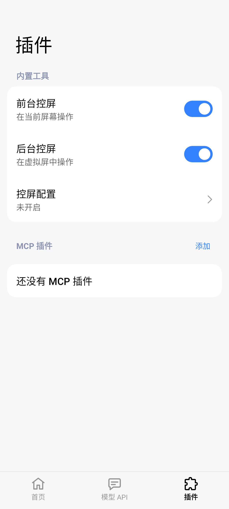

#  MiAIPlus

给超级小爱添加手机操作和 MCP 插件。默认使用小爱当前模型，**无需额外 API**，也可以接入自己的模型服务。

[下载 APK](https://github.com/astoHu1/MiAIPlus/releases) · [配置界面](docs/settings-ui.md) · [验证记录](docs/validation.md)

需要支持 miclaw 的 HyperOS 3+、支持 API 102 的 LSPosed，以及超级小爱 **8.2.65.4714 或 8.3.30.4420**。

## 能做什么

- **前台控屏**：打开应用、点击、滑动和输入。通知岛显示进度，随时可以停止。
- **后台控屏**：在虚拟屏里执行任务，主屏可以继续使用。需要给 MiAIPlus 授予 root 权限。
- **MCP 插件**：添加 HTTP MCP 服务，把它的工具交给小爱调用。
- **自定义模型**：保存多套模型配置，支持 Responses 和 Chat Completions。

## 开始使用

1. 安装 APK，在 LSPosed 启用 MiAIPlus，保持默认作用域。
2. 打开「插件 → 控屏配置」，开启「启用控屏工具」。规划模型保持「小爱当前模型」。
3. 开启 MiAIPlus 无障碍服务，并允许「后台弹出界面」。API 配置可以留空。
4. 重启小爱，说出具体任务，例如「打开计算器，清空当前结果」。

「插件」页可以分别开关前台和后台控屏。想让任务在虚拟屏执行，告诉小爱「在后台操作」。操作中可展开通知岛停止，结束后点击完成通知返回原对话。



## 添加 MCP 插件

1. 打开「插件」，点击「MCP 插件」右侧的「添加」。
2. 填写插件名称、完整服务地址和可选 Token，例如 https://example.com/mcp。
3. 保存后点击「获取工具」，在「工具列表」查看结果，再开启插件。

默认协议为 `2025-11-25`，服务需要旧版时可选择 `2025-06-18`。保存配置不会连接服务器。当前支持 Streamable HTTP 的工具调用；使用实例见 [Plugin 与 MCP 文档](docs/plugin-platform.md)。

## 使用自己的模型

在「模型 API」填写服务地址、API 密钥和模型名称，保存后开启「使用外部模型」，再重启小爱或热重载模块。协议可选自动、Responses 或 Chat Completions。控屏所用模型需要支持图片和工具调用。

语音识别、语音合成及米家等服务仍使用原链路。

## 排查问题

在「首页 → 日志」开启「详细日志」，复现后查看记录，或保存／分享 ZIP。默认关闭，不记录截图、页面正文和输入内容。详见 [日志说明](docs/phone-use-logging.md)。

「插件 → 控屏配置 → 操作确认」可选择手动确认、智能判断或自动执行。锁屏、密码、验证码和安全窗口等限制仍然生效。后台虚拟屏不是应用分身，兼容性因设备和应用而异；后台失败会停止任务。

## 构建

需要 JDK 17+、Android SDK 37 和 build-tools 37.0.0。

```sh
./gradlew :app:testDebugUnitTest :app:lintDebug :app:assemblePreview
```

日常试用使用优化的 Preview APK：`app/build/outputs/apk/preview/app-preview.apk`。Debug 用于调试。正式发布包使用发布签名，Preview 使用开发签名，二者不能直接覆盖升级。

GitHub Actions 会在 main／Pluginify 推送和 PR 时运行测试、Lint 与构建，产物在对应运行的 Artifacts。发布流程见 [发布说明](docs/releasing.md)。

## 更多说明

- [文档索引](docs/README.md) · [架构](docs/architecture.md) · [开发指南](AGENTS.md)
- [后台虚拟屏](docs/background-display.md) · [无障碍前置检查](docs/accessibility-guard.md)
- [API 102 与热重载](docs/api102-migration.md) · [第三方许可](NOTICE)

## 免责声明

LLM 存在不可避免的错误，该插件权限极高，请自行监控设备状况。小米公司和该模块所有贡献者对使用本模块产生的一切后果概不负责。
