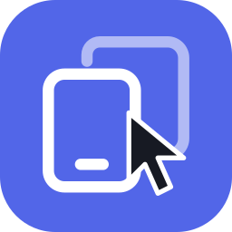

#  MiAIPlus

为超级小爱增加完善高自由度无限制的手机操作工具，也可接入你自己的模型服务。默认使用小爱当前模型，**无需额外 API**。

> 需要 支持 miclaw 的 HyperOS3+、支持 API 102 的 LSPosed，以及超级小爱 **8.2.65.4714 或 8.3.30.4420**。

## 能做什么

- **前台控屏**：让小爱打开应用、点击、滑动和输入文字，通知岛显示进度并提供停止按钮。
- **后台虚拟控屏**：在独立屏幕执行任务，主屏可继续使用。需要给 MiAIPlus 本身授予 root 权限，兼容性因设备而异。
- **自定义模型**：保存并切换多套模型服务，支持 Chat Completions / Responses；~~也可单独使用外部视觉模型规划控屏。~~ 这个还没做好啦（

## 开始使用

1. 安装 APK，在 LSPosed 启用 MiAIPlus，保持默认作用域。
2. 打开 MiAIPlus，开启控屏工具，并在系统无障碍设置中启用 MiAIPlus。
3. 控屏规划保持“小爱当前模型”，API 配置可以全部留空。如无法打开其他应用，请允许 MiAIPlus“后台弹出界面”。
4. 重启小爱，在聊天中提出具体任务，例如“打开计算器，清空当前结果”。

操作中可展开通知岛停止任务；结束后点击完成通知返回原对话。敏感操作可能需要确认或手动接管。

后台任务请明确告诉小爱“在后台操作”。前台和后台工具各自选择屏幕；设置中的默认屏幕仅影响兼容入口与直接测试。首次目标是主屏当前应用时会转前台；中途需要使用当前应用时通过通知岛征求同意，拒绝或超时就暂停。后台故障不会静默改到主屏执行。

遇到控屏问题，可在「首页 → 日志」开启详细日志后复现，直接在 App 内查看，或保存／分享日志 ZIP，无需连接电脑。默认关闭，记录诊断元数据，不含截图、页面正文和输入内容。详见 [日志说明](docs/phone-use-logging.md)。

## 使用自己的模型（可选）

在“模型服务”填写服务商提供的 Base URL、API Key 和模型名，保存后开启“外部模型对话”，再重启小爱或热重载模块。协议可选自动、Responses 或 Chat Completions；别名模型建议按服务商要求手动选择。

控屏模型需要支持图片和工具调用。若只想独立使用外部模型控屏，在“控屏规划”中选择“独立外部模型”，不必替换日常聊天模型。语音识别、语音合成及米家等服务仍使用原链路。

## 使用前须知

- 默认模式也会向官方小爱模型发送屏幕观察，并非离线运行；外部模式会向所选服务发送相应聊天、工具上下文及屏幕观察。
- 自动化仍可能选错位置或无法完成复杂任务，请关注执行过程。锁屏、密码、验证码、安全窗口及其他授权可能要求接管。
- 后台虚拟屏不是应用分身，不能保证同一应用在两块屏幕独立运行；理论兼容Android13+。

## 免责声明

LLM存在不可避免的错误，该插件权限极高，请自行监控设备状况，小米公司和该模块所有贡献者对使用本模块产生的一切后果概不负责。

## 构建与下载

需要 JDK 17+、Android SDK 37 / build-tools 37.0.0。

```sh
./gradlew :app:testDebugUnitTest :app:lintDebug :app:assemblePreview
```

试用 APK：`app/build/outputs/apk/preview/app-preview.apk`。Preview 为优化开销后的开发签名版本。Debug请勿使用。

GitHub Actions 在 main／Pluginify 推送、PR 和手动触发时执行测试、Lint 与构建；成功后在该次运行的 **Artifacts** 下载 APK、源码包和校验文件。

## TODO
- 优化Phone Use的工作效率
- You tell me

## 更多说明

- [文档索引与维护说明](docs/README.md) · [当前验证状态](docs/validation.md)

- [后台虚拟屏与限制](docs/background-display.md) · [应用启动](docs/app-launch.md) · [无障碍前置检查](docs/accessibility-guard.md)
- [配置界面](docs/settings-ui.md) · [API 102 与热重载](docs/api102-migration.md)
- [Plugin 平台与 HTTP MCP](docs/plugin-platform.md)
- [开发指南](AGENTS.md) · [架构与验证](docs/architecture.md)
- [第三方许可](NOTICE)
