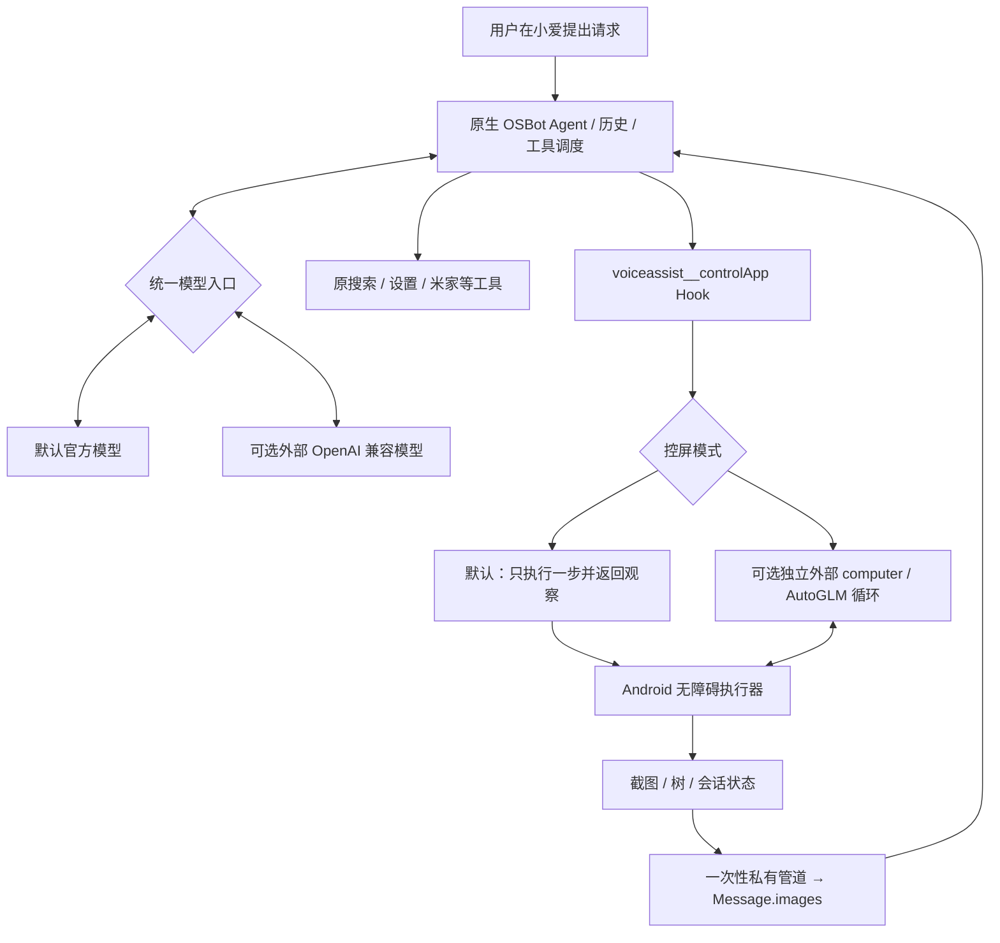

# 架构与选型

兼容性分析发现，旧 `UIAgentServiceForOSBot.controlApp(String)` 在一次实机请求中等待云端响应十秒后超时。该记录只证明该次响应失败，不能说明全部设备的服务永久停用。原模型的工具范围说明也限制了部分应用，仅替换底层执行器不足以解决路由问题。

`AgentLlmOverride` 只有模型 ID、思考/采样/上下文配置，不能通过它单独增加任意 API 地址。`0.2.3` 将控屏执行和模型选择分开。

## 默认官方模型控屏

`NativeSession` 在模块 UID 维护四分钟以内的会话、最近观察、最大步数和停止状态。首次请求返回 `CONTINUE`、会话号和观察；官方模型优先使用注册到原生 ToolRegistry 的 `miaiplus_computer` 函数提交 `session` 和 `action`；兼容入口接收 `MIAIPLUS:{session,action}`。结构化函数默认按实际 JPEG 像素接收坐标，也支持显式物理屏幕像素与0..1000；统一换算后再交给执行器。旧入口默认归一化坐标。结构化函数只在启用本机原生规划时加入模型工具列表，执行时再次校验配置。每步只执行一个数据动作，之后重新观察。对包含模块 CONTINUE 和截图 token 的 ToolResult.Success，清除直接答案标记与内部 CLI 直接答案 metadata，确保原 Agent 把中间观察回送模型；其他工具结果保持原行为。结束/接管显式关闭会话。

无外部端点配置也可工作，`AgentEngine` 在该模式下不调用 `ModelClient`。截图由 `FrameStore` 存入短期内存，以随机、一次性、调用 UID 绑定的 token 经 Provider 管道读取。`NativeModelHook` 优先在 ToolResult.Success 中附加 `ImageContent`，使原生 CLI 与消息历史复制保留图片；TOOL Message 构造 Hook 提供兼容读取。图片元数据采用实际 JPEG 尺寸，执行坐标仍以原屏归一化。截图不以 Base64 进入工具返回字符串或 Binder Bundle。

原官方模型及其传输链是否支持图片需要单独确认；不支持时有无障碍树可用，但纯图片页面受限。该实现没有内置 AutoGLM 模型权重，不能把模型名称与执行器协议混为一谈。

## 可选全局主模型替换

在当前精确支持版本上，`qm.c` 为 DynLlmClient，负责根据 `sm.a` 选择 Taiyi / OpenAI / Anthropic；`um.h` 是直接 Taiyi 客户端；同时接入 `qm.i`（OpenAI Chat Completions）、`qm.j`（OpenAI Responses）、`qm.b`（Anthropic）直接传输入口，覆盖绕开分发器构造客户端的调用。
开关关闭时不改推理配置；打开时为这些调用构造临时 OpenAI 配置，保留原消息列表、工具列表、systemPrompt、协程 Continuation 和原生 SSE 事件解析。使用原生 `qm.i` 客户端保留小爱原工具调用结果处理。为外部请求单独创建干净的 Ktor/OkHttp 客户端，仅安装 JSON 序列化与超时插件，关闭重定向，不使用原应用的 ServiceToken、设备签名、账号认证与网络日志拦截器。

API Key 仅在显式启用全局替换时经 UID 校验 IPC 交给小爱进程内存，不改小爱配置文件。该范围覆盖通过上述 OSBot 入口的聊天、Agent 与辅助推理；语音识别/合成、独立系统服务、独立云端推理入口不在这个 Hook 的声明范围内。切换后需重启小爱，清除已构造的客户端/描述和会话状态。

内部干净 OpenAI 委托使用同步线程重入保护，避免其被再次重定向；保护在原生 Flow 创建后即释放，不抑制其他调用。记忆摘要另走 `ep.j.o` 的非流式请求：同样替换临时模型配置，在同步构造请求期间通过线程局部标记替换 `er.a0.getClient()`，保留原重试、隐私编码、响应解析与协程取消机制；`finally` 对应的 Hook 后置阶段恢复标记。

全局模式复用原消息与 SSE 解析，但隔离网络认证；消息历史/会话缓存仍由原应用管理，与模块独立 `ModelClient` 不同。

## 独立 intent 请求

`NativeIntentHook` 仅处理路径严格为 `/osbot/api/intent/v2/chat/completions` 的 Ktor HttpStatement；全局开关关闭时原样放行。开启后复制原 JSON，更换模型、URL、认证与独立网络实例，并清除旧查询参数、认证头、计费 ID 和私有路由请求字段。

能力判断和记忆 gate 保留原 system/user 提示。intent-v2 路由把上下文转换成标准消息，要求 JSON 判断，并在原 router.t 响应解析入口把 message.content 转换回原格式。外部路由不直接分发未经注册校验的工具；统一 FALLBACK 给主 Agent，由其保留的工具链选择并执行。无有效 JSON 时保留原解析器的失败/回退行为。该适配使用原请求的超时、协程和重试机制。

## Open-AutoGLM 参考

选择 [Open-AutoGLM](https://github.com/zai-org/Open-AutoGLM)，参考 commit `86f55382982fb054e8fc98ca80609dff8a2cdc3c`，Apache-2.0。采用截图观察→模型规划→原子动作→重新观察的循环和 0..1000 坐标、`do(...)` / `finish(...)` 动作协议，以 Android Java 和 AccessibilityService 实现本机执行器。

未打包上游 Python/ADB 运行时、模型权重或任何小爱 APK/反编译源码。普通视觉模型可用模块自定义的标准 function tool `computer`，无需模仿 AutoGLM 文本格式。默认模式把同样的原子动作交给小爱当前主模型规划。

## 改动边界

Hook 仅安装在精确校验的小爱版本：工具入口、描述构造、PromptBuilder 路由、原生工具图片消息构造以及分发器和四个具体模型传输入口。安装失败撤销已安装 Hook；未改 APK、磁盘 osbot 提示词或系统服务。

原主模型/工具选择、无障碍支持、动态页面、模型图片能力、系统权限及原生 Agent 的回合预算都会影响结果。支付/发送等确认依赖模型标记；不绕过锁屏、安全窗口、密码框、验证码。无应用白名单不等于任意页面都可成功操作。

独立外部循环只保留最新截图与有限历史；默认原生循环的历史与图片生命周期由小爱原消息管理控制。具体通过及待验证项目见 `IMPLEMENTATION-STATUS.md`。
