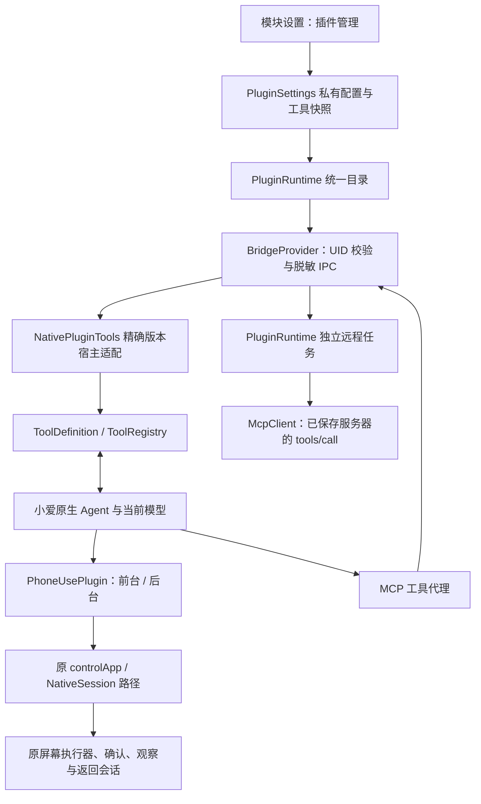

# 小爱 Plugin 注入平台

本文描述 `Pluginify` 分支于 2026-10-28 引入的源码实现与扩展方向，不代表已发布版本具有这些能力。检查分为 [首轮本地验证](validation/plugin-platform-2026-10-28.md)、[独立包实机验证](validation/plugin-platform-device-2026-10-28.md) 与 [真实 Termux MCP 验证](validation/termux-mcp-2026-10-28.md)，历史基线见 [验证摘要](validation.md)；MCP 协议取舍见 [MCP 调研](plugin-platform-mcp-research.md)。

## 可行性与分层

可以把前台 Phone Use、后台 Phone Use 和用户配置的 MCP 工具放到同一插件层级。现有实现已经有两项基础：向小爱 `ToolRegistry` 注册执行代理，以及向原生模型请求补充 `ToolDefinition`。本轮将这两项能力从 `NativePhoneUseTool` 中提取到统一的 `NativePluginTools`，由同一目录驱动注册、定义注入、启停和重载清理。

小爱继续管理主模型、原生工具选择、对话历史与 Agent 循环。MiAIPlus 管理新增插件的私有配置、工具目录和执行路由；没有另外启动一套主 Agent，也没有将 Phone Use 执行器改成任意远程插件可直接调用的公共接口。

### 当前组件

| 组件 | 职责 |
| --- | --- |
| `PluginToolSpec` | 不含连接凭证的工具契约：插件身份、类型、公开名、源工具名、显示名、说明、参数 schema 和超时 |
| `PluginSettings` | 私有插件集合、启停、连接凭证、已发现工具和原子 revision；损坏配置拒绝静默覆盖 |
| `PluginRuntime` | 按当前配置生成统一目录、手动发现、独立远程任务、UID 所有权、配置重验、超时和结果隔离 |
| `NativePluginTools` | 两个精确小爱版本的代理与 definition 适配、多注册表同步、碰撞保护、执行入口和重载清理 |
| `PhoneUsePlugin` | 两个第一方 Phone Use 工具的 schema、说明与原执行语义；`NativePhoneUseTool` 保留兼容 facade |
| `McpClient` | 按插件显式选择的协议版本进行 HTTP MCP 发现和调用；不使用宿主账号客户端、不引入完整 MCP SDK |
| `PluginState` / `PluginPage` | 独立插件页、编辑草稿、手动刷新、列表检查与启停 |

当前运行时只实现 `builtin` 和 `mcp` 两种插件类型。这是可扩展平台的第一阶段：新增 MCP 服务器不需要重新编译，新增执行后端仍需实现相应适配器。它不是任意 APK、DEX、Python 脚本或 shell 命令加载器。

## 使用插件

入口是「首页 → 插件」，原底栏「首页／模型 API／控屏」保持不变。

### 独立安装包

`Pluginify` 分支的安装包名为 `io.github.miaiplus.pluginify`，桌面名称为「MiAIPlus Pluginify」，可与主线 `io.github.miaiplus` 并装。源码 namespace 与组件类名仍为 `io.github.miaiplus`；例如 ADB 启动设置页应使用 `io.github.miaiplus.pluginify/io.github.miaiplus.MainActivity`。

两个 Provider authority、无障碍任务前检查、返回对话标记、宿主侧话题偏好、广播与通知标识按安装包身份隔离。独立包不会迁移主线配置，也不会清理主线旧 root guard。新增包需单独配置无障碍及 LSPosed 作用域；后台能力仍需该包自身的 root 授权。

并装不等于可以同时向小爱注入两套模块。测试或切换时应只启用其中一个模块的小爱作用域，再重启小爱，避免共同 Hook 原生流程及重复工具名。旧 `scripts/device_test.py` 等设备脚本仍包含主线包名，不能原样用于独立包；本分支的插件实机检查使用独立 runner。

### 内置 Phone Use

- 「前台 Phone Use」和「后台 Phone Use」与 MCP 插件在同一列表，各自可以启停，默认保持开启。
- 两者仍分别公开 `miaiplus_phone_use` 和 `miaiplus_background_phone_use`，不修改已有函数名与会话来源身份。
- 原「控屏」开关仍是 Phone Use 总开关。结构化 Phone Use 插件还要求规划模型为「小爱当前模型」；未满足时插件页给出配置入口。
- 旧 `voiceassist__controlApp` 兼容入口和设置中的直接控屏测试也检查对应内置插件开关，不能绕过停用状态。兼容入口的默认屏幕偏好仍只影响兼容入口与直接测试的新任务。
- 停用是在调用入口拒绝继续执行，不是撤销已经发生的点击、输入或远程操作。进行中的控屏任务仍可通过原停止入口停止。

### 添加 HTTP MCP

1. 选择「添加 MCP 插件」，填写名称、完整 Streamable HTTP 端点和可选 Bearer Token，并按服务支持情况选择协议：默认 `2025-11-25`，兼容选项 `2025-06-18`。端点使用服务实际地址，例如 `https://example.com/mcp`，模块不自动追加 `/mcp` 或模型 API 路径。
2. 保存。新插件默认停用，保存本身不连接服务器。
3. 点击「刷新工具」，显式连接服务器并读取 `tools/list`。成功后在「工具列表」检查公开的名称与说明；发现失败保留原目录。
4. 确认服务器及工具可信后开启插件。小爱可以选择该目录中的工具，调用参数会发往配置的服务器。
5. 修改连接地址、认证或协议身份后重新刷新工具。删除插件会删除其连接配置、认证和缓存目录。

握手响应必须与所选版本完全一致，即使响应是另一个已支持版本也会停止；模块不会自动降级或重发工具调用。协议选择保存在插件草稿与私有配置中，切换版本会清除该插件旧工具目录。

需要中止远程请求时，使用插件页的「停止 MCP 调用」。它请求取消模块当前所有 MCP 工具调用，不会停止 Phone Use；已发生的远端操作无法撤销。

公网端点要求 HTTPS。HTTP 仅允许显式本机回环或数字局域网地址，不提供传输加密。地址不接受用户信息、查询参数或 fragment；认证填写在单独的 Bearer Token 字段，不放在 URL 中。模块拒绝跟随 HTTP 重定向，应填写最终端点。

MCP 插件不依赖 Phone Use 总开关、无障碍服务、后台 root helper 或外部模型配置；它们只进入已适配的小爱原生 OSBot 工具链。是否被模型正确选择和使用仍取决于该模型及宿主入口，不代表全部语音云端 NLP 路径都能调用，也没有将其自动加入独立 `ModelClient` 的 Phone Use 规划循环。

目录在模型请求和工具执行前从模块刷新；注册表查询只同步最近快照，不发网络发现请求。停用会移除模块拥有的代理，持有旧代理的调用仍会重验并拒绝执行。为避免误删来自其他 DI 注册表的宿主定义，统一层只按对象身份删除确认由本代创建的 definition，不凭名称或 schema 猜测来源；当前请求中的缓存定义副本可能显示到下一轮请求或注册表查询。目录中仍显示旧副本不等于该工具仍可执行。

用户无需为了新增 MCP 服务器改代码，但首次安装或升级 Hook 仍需按原要求重启小爱或安全热重载。

### Termux shell 服务

2026-10-28 已使用现成的 `termuxgpt/termux-mcp` 服务验证手机端 shell，固定上游 commit 为 `48e3e58b3c8c5d66b97e79c0fa6473d126508f46`（`0.15.0`，AGPL-3.0）。服务源码保持上游实现，独立运行在已有 Termux Python 环境，不打包进模块，也不升级用户 Python／pip。该版本声明的 MCP 协议为 `2025-06-18`，插件应显式选择兼容版本；主测试工具为 `run_digest`，命令参数名为 `cmd`。

本轮服务仅监听手机 loopback，显式启用全局 Bearer 认证，并用独立 HOME 与配置目录隔离测试状态。模块真实 Provider 验证了 Termux UID／环境、中文文件读写、管道、哈希和失败语义；小爱进程中的当前模块工具代理另行执行固定身份命令，确认实际宿主也能调用同一真实服务。这不是模型自主选择或长期 shell 会话的验收。独立 HOME 只隔离状态，不限制 shell 能力：服务仍可执行 Termux UID 有权执行的命令。Phone Use 的敏感操作确认不会自动覆盖这些远程 shell 命令。

上游 `run_digest` 的 `isError=true` 会作为模块调用失败，当前模块返回脱敏错误，不把服务器错误正文、stderr 或数字退出码直接交给宿主。原始上游响应中的 stdout／stderr 与退出码 `7` 已另行检查，不能将其误写成模块错误正文已完整透传。启动适配、认证、实际命令和验证边界见 [Termux 实机记录](validation/termux-mcp-2026-10-28.md)。

## 已实现的 MCP 范围

本轮明确支持用户显式选择 **`2025-11-25`（默认）** 或 **`2025-06-18`（兼容）**，只实现这两版基于初始化握手的 Streamable HTTP 工具子集，不把它称为当前所有 MCP 规范的完整实现。协议演进与选择依据见 [MCP 调研](plugin-platform-mcp-research.md)。

| 能力 | 当前行为 |
| --- | --- |
| 生命周期 | `initialize` → 校验响应严格匹配所选版本及 tools 能力 → `notifications/initialized` |
| 发现 | `tools/list`，支持有界分页，拒绝重复名称、循环 cursor 和超量工具 |
| 调用 | `tools/call`，源工具名只从本地已发现目录解析，模型不能指定连接地址或替换认证 |
| 传输 | HTTP POST；接收 JSON 或有界 SSE，按 JSON-RPC 请求 ID 匹配完整响应 |
| 会话 | 每次发现或执行独立建立客户端；同次握手中的 session ID 只发回原端点，不共享长期 session |
| 输出 | 文本与 `structuredContent`；远端 `isError` 保留失败语义 |
| 认证 | 用户显式保存的可选 Bearer Token；没有 OAuth 登录、刷新令牌或认证发现 |
| 取消 | 断开本地连接、拒绝迟到结果，不开启新的清理网络请求，也不自动重放调用 |

当前不支持 stdio、本地子进程、旧独立 SSE 端点、2026 年新协议形态、resources、prompts、sampling、elicitation、客户端 roots、服务端向客户端发起的请求、远程图片／音频／资源内容、自动处理 `list_changed` 或跨调用长期会话。收到不支持的内容或客户端能力请求会明确失败，不自动读取远端给出的本地文件、`content://` 或资源 URI。

关闭客户端不发送额外的 session DELETE；服务器自行管理遗留 session 的过期。网络断开、超时或本地取消不能证明服务端尚未执行，也不能回滚已经产生的副作用，所以调用失败后不会自动重试 `tools/call`。

### 有界执行

| 限制 | 当前值 |
| --- | --- |
| 每个 MCP 插件已发现工具 | 最多 64 个 |
| 启用目录工具总数 | 最多 128 个 |
| 发给宿主的目录 | 最多 96 × 1024 个 UTF-16 代码单元，给 Binder 留出余量 |
| 同时执行的远程工具任务 | 最多 2 个，与控屏执行队列分离 |
| 调用参数／结果 | 参数最多 32 × 1024、结果最多 64 × 1024 个 UTF-16 代码单元 |
| HTTP 请求／响应 | 请求最多 128 KiB，单个响应最多 256 KiB |
| 超时 | MCP 客户端总预算 60 秒，连接／读取最长各 15 秒；模块任务 62 秒、宿主等待 65 秒 |

目录、说明、schema、JSON 嵌套、会话头和分页均有额外边界。配置变更在原子提交前校验最终启用组合，并始终为两个内置 Phone Use 定义预留空间；超限启用或更新不会先写入再使整个目录失效。超限拒绝执行或更新，不以截断后的不完整 schema 冒充可调用工具。

## 身份、权限与生命周期

插件集合和凭证存放在模块私有 `SharedPreferences`，采用一个 JSON 值原子提交；编辑草稿仅留在 ViewModel，不进入 SavedState。宿主通过已校验 UID 的 `BridgeProvider` 获取 revision 和工具定义，目录中没有服务器地址、认证字段或私有请求头。

MCP 工具公开名采用 `miaiplus_mcp_<插件 UUID 去横线>_<源工具名 SHA-256 前 16 位十六进制>`，稳定且长度为 62 个字符。模块拒绝目录内重名；宿主已有同名工具优先，不覆盖或据为己有。清理只删除仍指向本代代理的注册项。

发现以开始时的配置 revision 提交结果，修改、删除或切换配置后迟到发现不能覆盖新配置。新工具调用也按当前目录 revision 准入，旧代理不能继续使用已停用或已更改的目录。已经接收的 MCP 调用则只重验自身插件的启用状态、连接／认证／协议身份及正在调用的工具契约；修改 Phone Use 开关、其他插件或本插件的纯显示名称不会取消它。改变自身连接身份、停用／删除自身插件或改变所调用工具契约后，旧结果不再交付；这不代表服务端没有执行。模块任务绑定调用 UID 与随机请求 ID，取消旧请求不能作用于新请求。

远程任务不占用 `BridgeProvider` 的控屏 `active`／`screen_task`，也不调用通用「停止控屏」来取消 MCP。宿主代理在整个同步调用期间保持 `Hooks.enter/leave` 计数；热重载还检查模块远程任务是否真正清理结束。取消已请求、连接仍在退出时继续拒绝重载。

两版小爱原生 `Tool.onCancel` 没有已确认可可靠绑定到具体远程调用的上下文，因此本轮 MCP 代理保持 `isStoppable=false`，不保证点击小爱原生停止按钮会取消远端请求。当前可用的本地中止方式是插件页「停止 MCP 调用」、宿主执行线程中断、超时或自身配置失效；其中设置页停止只由模块本地动作触发，不向其他 UID 暴露批量取消 IPC。上述方式都只能停止本地等待并请求断开连接，不能撤销服务器副作用。

远程返回被标为远程数据，并转义保留的 `MIAIPLUS_FRAME:` 和控屏 CONTINUE 文本，不能伪装成一次性本地截图能力或 Phone Use 状态。第三方工具失败不被包装为 Phone Use 停止指令，不取消另一个控屏任务。

Phone Use 仍走原来的 `PhoneUseRouting → controlApp → BridgeProvider → NativeSession/AgentEngine`，保留源工具／UID／会话所有权、一次性截图、PageGuard、敏感动作确认、锁屏／安全窗口／密码／验证码限制，以及完成后返回原对话的规则。后台故障仍停止，只有既有明确应用冲突交接允许按原同意规则切换前台。

**启用一个 MCP 插件等于允许小爱选择该服务器提供的工具。** Phone Use 的确认机制只约束本地控屏，不会自动审计或批准所有远程工具的业务副作用。远程服务的权限、账户范围和副作用确认仍需由服务本身及其认证配置落实；annotations 或工具说明不能授予模块 root、无障碍或跳过本地确认的能力。

## 后续扩展

当前共享契约已经覆盖「身份／配置 → 发现目录 → 命名与 schema → 启停 → 调用与取消 → 清理」。继续增加后端时，应在插件适配层实现这些边界，复用统一的宿主注册与模型定义注入，不为每种工具重复 Hook 一套原生注册表。

建议按能力分期：

1. 在已有小爱 8.3.30 合成服务／真实宿主探针基础上，继续完成另一受支持版本、真实模型及生产 MCP 服务验收，再决定是否发布这一阶段。
2. 新 MCP 协议、OAuth、资源和多媒体分别作为明确的新协议／能力适配，不在旧握手失败时盲目猜测或降级。
3. 增加每工具授权、来源标识、可见调用状态与安全结果展示，再评估更广泛的第三方工具包格式。
4. 如未来需要本地代码插件、stdio 或动态加载，另行设计进程隔离、安装信任与权限契约；当前 HTTP MCP 实现不构成这些能力的授权或实现。

不同 Harness 的记忆、技能、提示、资源、生命周期 Hook 和多 Agent 调度不全等价于 function tools。它们若要进入小爱，需要逐项映射到宿主实际支持的入口，不能仅靠给工具目录改名就宣称通用兼容。

## 验证边界

独立包阶段 506 项 JVM／Robolectric 测试通过，Debug／Release Lint 零错误，Debug／Release／Preview 与 AndroidTest 构建通过。API 37／小爱 8.3.30 已验证实际宿主三类工具注册／schema、原生 MCP 代理、Android 合成服务 HTTP、前台与空后台屏附图／wait／finish，以及手机插件页。后台测试使用正常管理界面临时授予新包 root，完成后撤销；收尾恢复主线作用域，保留 Pluginify 优化安装包但停用其模块。详细命令、失败尝试、APK 摘要及恢复见 [实机记录](validation/plugin-platform-device-2026-10-28.md)。

后续 Termux 阶段 513 项 JVM／Robolectric 测试通过，双变体 Lint 零错误，各 APK 构建成功；真实上游服务的 Android Provider／小爱宿主代理调用与文件管道验证通过，见 [Termux 实机记录](validation/termux-mcp-2026-10-28.md)。该结论限于所固定服务与命令，不代表任意第三方服务、模型自主工具选择或复杂前后台应用任务通过；另一受支持小爱版本与旧 Android 设备未复测。桌面 loopback、本地深浅色渲染和首轮 499 项测试另见 [首轮记录](validation/plugin-platform-2026-10-28.md)。不能把历史 Phone Use 或单项探针结果扩展为本分支全部能力验收。
