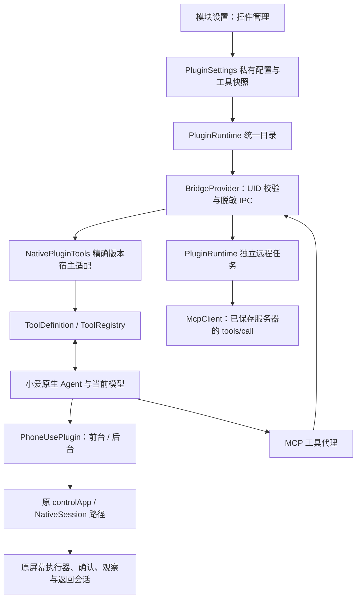

# 小爱 Plugin 注入平台

MiAIPlus 用统一插件目录向小爱原生 Agent 注册工具，管理配置、启停、执行路由和重载清理；小爱负责模型、历史和工具循环。支持内置 Phone Use、Termux、Eta 及用户配置的 HTTP MCP。协议依据见 [MCP 调研](plugin-platform-mcp-research.md)，验证见 [摘要](validation.md)。

## 分层

### 当前组件

| 组件 | 职责 |
| --- | --- |
| `PluginToolSpec` | 不含连接凭证的工具契约：插件身份、类型、公开名、源工具名、显示名、说明、参数 schema 和超时 |
| `PluginSettings` | 私有插件集合、启停、连接凭证、已发现工具和原子 revision；损坏配置拒绝静默覆盖 |
| `PluginRuntime` | 按当前配置生成统一目录、手动发现、独立远程任务、UID 所有权、配置重验、超时和结果隔离 |
| `NativePluginTools` | 两个精确小爱版本的代理与 definition 适配、多注册表同步、碰撞保护、执行入口和重载清理 |
| `PhoneUsePlugin` | 两个第一方 Phone Use 工具的 schema、说明与原执行语义；`NativePhoneUseTool` 保留兼容 facade |
| `McpClient` | 按插件显式选择的协议版本进行 HTTP MCP 发现和调用；不使用宿主账号客户端、不引入完整 MCP SDK |
| `PluginState` / `PluginPage` | 独立插件页、编辑草稿、手动刷新、列表检查与启停 |

运行时支持内置控屏（`builtin`）、手动配置的 MCP（`mcp`）以及固定回环配置的内置 Termux（`termux`）。新增 HTTP MCP 服务器不需要重新编译，新增执行后端仍需实现相应适配器。它不是任意 APK、DEX、Python 脚本或 shell 命令加载器。

## 使用插件

底栏为「首页／模型 API／插件」，「插件」是一级入口，首页另保留插件概览快捷入口。原控屏设置通过内置 Phone Use 的「控屏配置」进入，虚拟屏位于其下；这两页均保持「插件」标签选中，返回逐级回到控屏配置、插件页和首页。导航调整与本地检查见 [插件底栏记录](validation/settings-plugins-tab-2026-10-28.md)。

### 内置 Phone Use

- 「前台控屏」和「后台控屏」放在「内置工具」分组，各自可以启停，默认保持开启。
- 两者仍分别公开 `miaiplus_phone_use` 和 `miaiplus_background_phone_use`，不修改已有函数名与会话来源身份。
- 原「控屏」开关仍是 Phone Use 总开关。结构化 Phone Use 插件还要求规划模型为「小爱当前模型」；未满足时插件页给出配置入口。
- 旧 `voiceassist__controlApp` 兼容入口和设置中的直接控屏测试也检查对应内置插件开关，不能绕过停用状态。兼容入口的默认屏幕偏好仍只影响兼容入口与直接测试的新任务。
- 停用是在调用入口拒绝继续执行，不是撤销已经发生的点击、输入或远程操作。进行中的控屏任务仍可通过原停止入口停止。

### 添加 HTTP MCP

1. 点击「MCP 插件」右侧的「添加」，填写名称、完整 Streamable HTTP 端点和可选 Bearer Token，并按服务支持情况选择协议：默认 `2025-11-25`，兼容选项 `2025-06-18`。端点使用服务实际地址，例如 `https://example.com/mcp`，模块不自动追加 `/mcp` 或模型 API 路径。
2. 保存。新插件默认停用，保存本身不连接服务器。
3. 点击「获取工具」（已有目录时为「刷新工具」），显式连接服务器并读取 `tools/list`。成功后在「工具列表」检查公开的名称与说明；发现失败保留原目录。
4. 确认服务器及工具可信后开启插件。小爱可以选择该目录中的工具，调用参数会发往配置的服务器。
5. 修改连接地址、认证或协议身份后重新刷新工具。删除插件会删除其连接配置、认证和缓存目录。

握手响应必须与所选版本完全一致，即使响应是另一个已支持版本也会停止；模块不会自动降级或重发工具调用。协议选择保存在插件草稿与私有配置中，切换版本会清除该插件旧工具目录。

公网端点要求 HTTPS。HTTP 仅允许显式本机回环或数字局域网地址，不提供传输加密。地址不接受用户信息、查询参数或 fragment；认证填写在单独的 Bearer Token 字段，不放在 URL 中。模块拒绝跟随 HTTP 重定向，应填写最终端点。

MCP 插件不依赖 Phone Use 总开关、无障碍服务、后台 root helper 或外部模型配置；它们只进入已适配的小爱原生 OSBot 工具链。是否被模型正确选择和使用仍取决于该模型及宿主入口，不代表全部语音云端 NLP 路径都能调用，也没有将其自动加入独立 `ModelClient` 的 Phone Use 规划循环。

目录在模型请求和工具执行前从模块刷新；注册表查询只同步最近快照，不发网络发现请求。停用会移除模块拥有的代理，持有旧代理的调用仍会重验并拒绝执行。为避免误删来自其他 DI 注册表的宿主定义，统一层只按对象身份删除确认由本代创建的 definition，不凭名称或 schema 猜测来源；当前请求中的缓存定义副本可能显示到下一轮请求或注册表查询。旧副本的执行仍受当前配置校验。

用户无需为了新增 MCP 服务器改代码，但首次安装或升级 Hook 仍需按原要求重启小爱或安全热重载。

### Termux shell 服务

当前源码在「内置工具」提供 **Termux MCP**。设备安装兼容的 Termux 后，进入「插件 → Termux 配置」，点「自动配置」即可配置并启用。工具启停通过插件页的「Termux MCP」主开关控制。配置需要 MiAIPlus 的 root 授权；首次未初始化时会打开 Termux 完成初始化，缺少 Python 时使用 Termux 软件源安装。模块内置固定版本的上游程序，生成私有 Token 和本机端点，验证服务及工具清单后才公开工具。手动添加的 HTTP MCP 配置独立保留。

「按需启动 Termux」默认关闭：服务不在运行时，可在「Termux 配置」页点「启动服务」。打开开关后，已解锁的设备在工具调用前可后台启动 Termux，不打开终端界面，不在开机时启动，也不会自动安装软件或重发命令。部分 HyperOS 会阻止后台启动，模块会尝试仅在发送启动请求期间临时放行 Termux，然后恢复原设置。如果通过系统「强行停止」Termux，请在「Termux 配置」页重新配置以恢复。关闭工具会从小爱移除工具；关闭按需启动只禁止后续自动启动，均不终止正在运行的 Termux 服务。命令的权限由 Termux 决定，隔离 HOME 不是 shell 沙箱；模型不能传入上游的 `confirmed` 参数。

2026-10-28 的手动接入验证使用了 `termuxgpt/termux-mcp`，固定上游 commit 为 `48e3e58b3c8c5d66b97e79c0fa6473d126508f46`（`0.15.0`，AGPL-3.0）。内置版继续使用该版本的独立服务和 `2025-06-18` 协议，并从 2026-11-11 增加独立的受管 Bash 执行适配器；`run_digest` 的命令参数名为 `cmd`。

服务仅监听手机 loopback，使用全局 Bearer 认证及独立 HOME／配置目录。HOME 隔离状态，命令仍具有 Termux UID 的权限；Phone Use 确认不覆盖 shell 命令。接入验证见 [Termux 实机记录](validation/termux-mcp-2026-10-28.md)。

内置 Termux 工具可并行运行独立命令，最多同时执行 4 条；同一批最多 12 条在途（含排队）。调用之间不共享工作目录或 shell 变量；先写后读、读取 `out_ref` 等依赖操作要等上一步返回。新版受管服务把原始 `cmd` 交给 Bash，命令开头的 `cd` 及引号也按 Bash 语义执行；可以显式传入 `cwd`。同步时限可配至 40 秒，后台任务最长 120 秒，配套 `job_status`／`job_cancel`；执行槽位、结果引用和旧服务升级边界见 [执行契约](termux-tools.md)。

内置 Termux 的工具错误（例如命令非零退出、诊断或策略拒绝）经过结果大小检查和凭证清理后交给模型继续判断；桥接失败、配置失效和取消仍走失败路径，模块不会重发命令。手动配置的第三方 HTTP MCP 保持原先的脱敏错误处理。旧版提前结束的实测现象见 [真实会话记录](validation/termux-harness-2026-11-06.md)。

### Eta 外部 Agent

内置工具中的 **Eta Agent**（kind `eta`）把本机 Eta 应用作为外部 Agent 提供给小爱，工具为 `miaiplus_eta_run` 和 `miaiplus_eta_status`。它不同于 MCP 与 Termux：任务在小爱宿主进程内经 Messenger 中转（Eta 只接纳其自身与小爱等助手包的 UID），不经模块进程的远程任务队列。目录仅在开关开启且 Eta 通过包名、官方签名、版本和服务入口校验时出现，默认关闭；Eta 不被修改或打包。工具契约、限制和异常处理见 [Eta 外部 Agent](eta-agent.md)。

## 已实现的 MCP 范围

支持显式选择 **`2025-11-25`（默认）** 或 **`2025-06-18`（兼容）** 的 Streamable HTTP 工具子集。协议演进与选择依据见 [MCP 调研](plugin-platform-mcp-research.md)。

| 能力 | 当前行为 |
| --- | --- |
| 生命周期 | `initialize` → 校验响应严格匹配所选版本及 tools 能力 → `notifications/initialized` |
| 发现 | `tools/list`，支持有界分页，拒绝重复名称、循环 cursor 和超量工具 |
| 调用 | `tools/call`，源工具名只从本地已发现目录解析，模型不能指定连接地址或替换认证 |
| 传输 | HTTP POST；接收 JSON 或有界 SSE，按 JSON-RPC 请求 ID 匹配完整响应 |
| 会话 | 每次发现或执行独立建立客户端；同次握手中的 session ID 只发回原端点，不共享长期 session |
| 输出 | 文本与 `structuredContent`；远端 `isError` 保留失败语义 |
| 认证 | 用户显式保存的可选 Bearer Token；没有 OAuth 登录、刷新令牌或认证发现 |
| 取消 | 断开本地连接、拒绝迟到结果，不开启新的清理网络请求，也不自动重放调用 |

当前不支持 stdio、本地子进程、旧独立 SSE 端点、2026 年新协议形态、resources、prompts、sampling、elicitation、客户端 roots、服务端向客户端发起的请求、远程图片／音频／资源内容、自动处理 `list_changed` 或跨调用长期会话。收到不支持的内容或客户端能力请求会明确失败，不自动读取远端给出的本地文件、`content://` 或资源 URI。

关闭客户端不发送额外的 session DELETE；服务器自行管理遗留 session 的过期。网络断开、超时或本地取消不能证明服务端尚未执行，也不能回滚已经产生的副作用，所以调用失败后不会自动重试 `tools/call`。

### 有界执行

| 限制 | 当前值 |
| --- | --- |
| 每个 MCP 插件已发现工具 | 最多 64 个 |
| 启用目录工具总数 | 最多 128 个 |
| 发给宿主的目录 | 最多 96 × 1024 个 UTF-16 代码单元，给 Binder 留出余量 |
| 同时执行的远程工具任务 | 第三方 MCP 最多 2 个；内置 Termux 最多 4 个执行、12 个在途；均与控屏执行队列分离 |
| 调用参数／结果 | 参数最多 32 × 1024、结果最多 64 × 1024 个 UTF-16 代码单元 |
| HTTP 请求／响应 | 请求最多 128 KiB，单个响应最多 256 KiB |
| 超时 | MCP 客户端总预算 60 秒，连接最长 15 秒、读取最长 15 秒（受管 Termux 为 20 秒，以容纳 15 秒 SSE 保活）；模块任务 62 秒（包括排队和启动），宿主等待 65 秒 |

目录、说明、schema、JSON 嵌套、会话头和分页均有额外边界。配置变更在原子提交前校验最终启用组合，并始终为两个内置 Phone Use 定义预留空间；超限启用或更新不会先写入再使整个目录失效。超限拒绝执行或更新，不以截断后的不完整 schema 冒充可调用工具。

## 身份、权限与生命周期

插件集合和凭证存放在模块私有 `SharedPreferences`，采用一个 JSON 值原子提交；编辑草稿仅留在 ViewModel，不进入 SavedState。宿主通过已校验 UID 的 `BridgeProvider` 获取 revision 和工具定义，目录中没有服务器地址、认证字段或私有请求头。

MCP 工具公开名采用 `miaiplus_mcp_<插件 UUID 去横线>_<源工具名 SHA-256 前 16 位十六进制>`，稳定且长度为 62 个字符。模块拒绝目录内重名；宿主已有同名工具优先，不覆盖或据为己有。清理只删除仍指向本代代理的注册项。

发现以开始时的配置 revision 提交结果，修改、删除或切换配置后迟到发现不能覆盖新配置。新工具调用也按当前目录 revision 准入，旧代理不能继续使用已停用或已更改的目录。已经接收的 MCP 调用则只重验自身插件的启用状态、连接／认证／协议身份及正在调用的工具契约；修改 Phone Use 开关、其他插件或本插件的纯显示名称不会取消它。改变自身连接身份、停用／删除自身插件或改变所调用工具契约后，旧结果不再交付；这不代表服务端没有执行。模块任务绑定调用 UID 与随机请求 ID，取消旧请求不能作用于新请求。

远程任务不占用 `BridgeProvider` 的控屏 `active`／`screen_task`，也不调用通用「停止控屏」来取消 MCP。宿主代理在整个同步调用期间保持 `Hooks.enter/leave` 计数；热重载还检查模块远程任务是否真正清理结束。取消已请求、连接仍在退出时继续拒绝重载。

两版小爱原生 `Tool.onCancel` 没有已确认可可靠绑定到具体远程调用的上下文，因此本轮 MCP 代理保持 `isStoppable=false`，不保证点击小爱原生停止按钮会取消远端请求。宿主执行线程中断、超时或自身配置失效可中止本地等待。插件页不提供批量停止按钮，也不向其他 UID 暴露批量取消 IPC。上述方式都只能停止本地等待并请求断开连接，不能撤销服务器副作用。

远程返回被标为远程数据，并转义保留的 `MIAIPLUS_FRAME:` 和控屏 CONTINUE 文本，不能伪装成一次性本地截图能力或 Phone Use 状态。第三方工具失败不被包装为 Phone Use 停止指令，不取消另一个控屏任务。

Phone Use 仍走原来的 `PhoneUseRouting → controlApp → BridgeProvider → NativeSession/AgentEngine`，保留源工具／UID／会话所有权、一次性截图、PageGuard、敏感动作确认、锁屏／安全窗口／密码／验证码限制，以及完成后返回原对话的规则。后台故障仍停止，只有既有明确应用冲突交接允许按原同意规则切换前台。

**启用一个 MCP 插件等于允许小爱选择该服务器提供的工具。** Phone Use 的确认机制只约束本地控屏，不会自动审计或批准所有远程工具的业务副作用。远程服务的权限、账户范围和副作用确认仍需由服务本身及其认证配置落实；annotations 或工具说明不能授予模块 root、无障碍或跳过本地确认的能力。

## 扩展与验证

新增后端应复用统一目录、注册和定义注入，在适配层实现配置、发现、命名、启停、调用、取消与清理。新 MCP 协议、OAuth、资源、多媒体或本地代码加载需要各自的协议和权限设计。

- [首轮本地验证](validation/plugin-platform-2026-10-28.md)：目录、协议及设置渲染。
- [独立包实机验证](validation/plugin-platform-device-2026-10-28.md)：实际宿主注册、合成 MCP HTTP、前后台观察与设置页。
- [真实 Termux MCP 验证](validation/termux-mcp-2026-10-28.md)：固定上游服务的 Provider／宿主调用及文件管道。

这些记录未覆盖另一受支持小爱版本、旧 Android、任意生产 MCP 服务或复杂模型任务。
