# 模块配置界面

设置界面使用 Compose 与 Miuix。当前验证结果见 [验证摘要](validation.md)。

「首页 → 日志 → 更多」可切换默认关闭的「详细日志」，与「插件 → 控屏配置 → 诊断」同步，保存后无需重启。采集、筛选和 ZIP 导出见 [详细日志](phone-use-logging.md)。

## 页面

底栏固定按「首页 → 模型 API → 插件」排列，使用 Miuix 原生 `NavigationBar` / `NavigationBarItem`。插件页使用拼图图标，统一列出内置工具与 HTTP MCP 插件。「控屏配置」和「Termux 配置」是同级入口，虚拟屏继续位于控屏页下。

导航使用单一返回栈，栈底为当前标签。二级页返回实际来源页；点按标签回到该标签根页，非首页根页按返回回到首页。重建后保留返回栈。

设置行按含义区分：带箭头的 `ArrowPreference` 打开页面、对话框或系统设置；无箭头、主色标题的操作行立即执行（重载模块、检查前置条件、获取工具、启动服务）；删除类操作使用错误色标题；无点击的行只显示状态。密钥与 Token 输入框使用框内眼睛图标切换显示，不再占用单独开关行。

模型 API 列表的滚动区域延伸到底栏或未保存配置操作栏上沿；24 dp 尾部留白放在列表内容内，随末项滚动，避免底栏上方固定空出一条并提前截断卡片。

| 页面 | 内容 | 保存方式 |
| --- | --- | --- |
| 首页 | KernelSU 式状态卡、模块版本、无障碍状态；「功能」插件与控屏入口（附开关与规划模型摘要）；「对话」语音回复与系统提示词；「诊断」运行状态与日志 | 状态只读；语音回复即时保存 |
| 日志 | 详细日志开关、自动刷新、搜索／来源筛选、记录详情、保存／分享 ZIP、清空 | 首页进入；顶部图标保存／分享，更多菜单管理开关／刷新／清空 |
| 模型 API | 配置切换、地址与密钥、模型列表、API 协议、外部对话开关 | API 配置显式保存；切页时可保存、放弃或取消 |
| 插件 | 内置 Phone Use 与 Termux MCP 启停、配置入口、HTTP MCP 插件列表 | 底栏或首页进入；内置项即时保存 |
| MCP 插件详情 | 启用、服务地址与协议、编辑连接、工具列表与参数详情、获取／刷新工具、删除 | 插件列表点按进入，新建保存后自动进入；连接配置显式保存 |
| 控屏 | 启用开关、规划模型、动作协议、最大步数、虚拟屏入口、权限 | 首页或插件页进入；即时保存；步数限制 1–200，默认 30 |
| Termux 配置 | 按需启动 Termux、启动服务、自动配置／重新配置 | 插件页进入；开关即时保存，服务操作手动触发 |
| 虚拟屏 | 执行开关、画布分辨率、前置检查、测试应用、逐项能力检测 | 控屏或运行状态页进入；画布显式保存，检查与检测手动触发 |
| 运行状态 | 注入报告、框架与热重载、权限、直接测试与虚拟屏入口 | 首页进入；虚拟屏返回运行状态 |
| 直接测试 | 外部模型控屏与纯对话 | 运行状态页进入；只用已保存配置 |

首页的注入结果来自持久化报告，注明「上次」并显示报告时间，不将历史报告或控屏开关显示为实时连接。无报告时提示启用模块并重启小爱。

首页注入报告卡显示上次报告状态与时间。「版本／无障碍」概览卡复用 Miuix `BasicComponent`：17 sp 中等字重标题、14 sp 次要色说明、16 dp 内边距，两卡等高并跟随系统字体缩放。

日志页隐藏底栏，返回首页；开关、刷新和清空收进「更多」。列表显示筛选后最近 500 条，导出包含全部保留记录，读取和压缩在后台执行。以下为合成元数据的 Robolectric 渲染：

| 浅色 | 深色 |
| --- | --- |
| 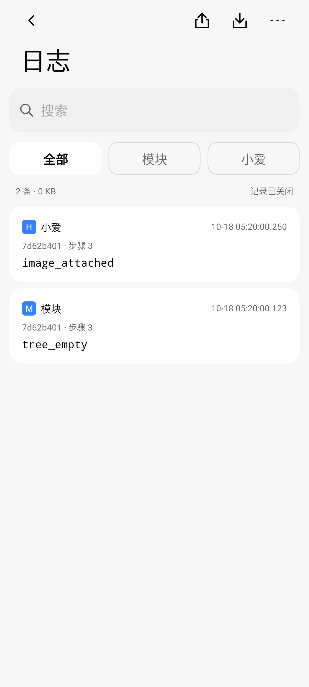 |  |

数字编辑框在 OverlayDialog 外保留 `TextFieldValue`，同步光标、选区和输入法合成区；取消重开时恢复已保存值。回归见 [数字输入记录](validation/number-input-2026-11-16.md)。

二级页使用 240 ms 位移与淡入淡出，结束后释放旧页面；退出页面不接收点击或无障碍焦点。底栏切换使用 220 ms 淡入和 24 dp 水平滑入，方向随标签顺序，连续点击以最后选择为准，系统关闭动画时跟随关闭。模型表单按分组懒加载，各页保留滚动位置。首页和表单不轮询；运行状态页每 3.5 秒、日志页每 2 秒刷新，退出页面或后台时停止。返回前台刷新完整诊断。

MCP「添加」文字按钮与分组标题居中、对齐卡片内容边缘，点击高度 48 dp。

插件页分为「内置工具」和「MCP 插件」；具体操作见下方[插件页](#插件页)。

界面沿用 Miuix 0.9.4 控件、间距和颜色，跟随系统深浅色，内容最大宽度 680 dp。

小型下拉选择和日志更多菜单使用 `SettingsListPopup`，保留 Miuix 的选中态、定位、动画和关闭方式，增加阴影与 0.5 dp 描边。确认／编辑对话框沿用原样式。开启「小爱对话 → 使用外部模型」会将规划模型保存为「小爱当前模型」并禁用该选择；关闭后可手动选择独立外部规划。

以下为合成默认配置的 Robolectric 渲染，展示展开菜单与相邻设置卡片的层次；另覆盖了 320 dp 宽度与 1.5 倍系统字体，菜单选项完整可见。

| 浅色菜单 | 深色菜单 |
| --- | --- |
| 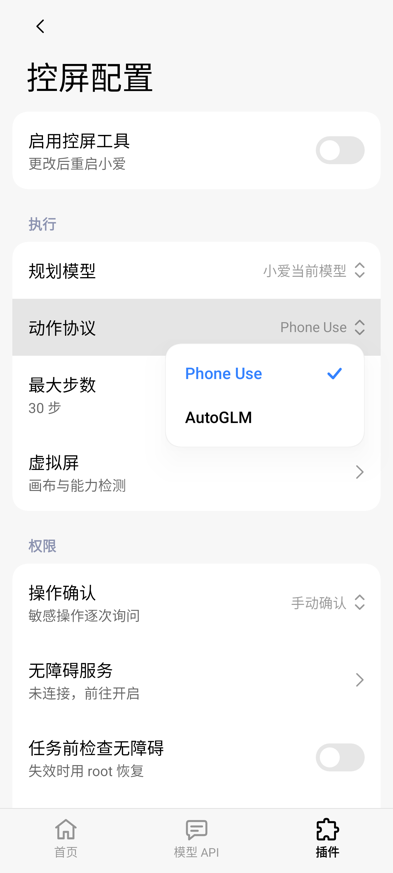 | 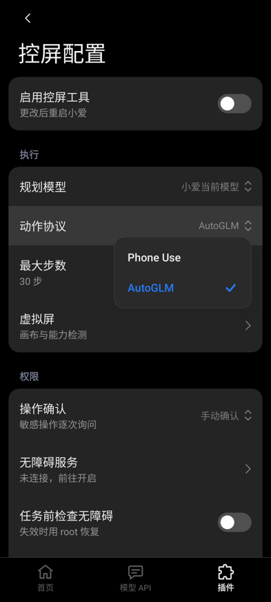 |

「插件 → 控屏配置 → 操作确认」提供「手动确认／智能判断／自动执行」（Manual／Auto／YOLO），默认手动确认，对新任务生效。具体行为和系统权限边界见 [Phone Use 权限](phone-use-permissions.md)。

「执行 → 动作协议」可选 Phone Use、AutoGLM 和 Eta（`protocol=phone_use|autoglm|eta`）。选择 Eta 后禁用规划模型，由 Eta 完成全部控屏请求；摘要显示其安装、签名和版本可用性，操作确认预设不作用于 Eta。见 [Eta 控屏协议](eta-agent.md#控屏协议eta)。

## 虚拟屏

「控屏 → 虚拟屏」管理兼容入口的默认屏幕偏好 `backgroundDisplay`，默认关闭，开关位于虚拟屏页；首页控屏摘要显示启用状态与规划模型。开关影响后续通过兼容入口发起的新任务，进行中的任务保持原屏幕；关闭选用主屏，开启选用虚拟屏。原生 `miaiplus_phone_use`／`miaiplus_background_phone_use` 分别选择前台／后台，不受此默认偏好影响。后台不可用时停止，不静默回退物理屏。

- 画布可自定义宽、高和密度，分别限制为 320–4096 像素、80–1000 dpi；默认保持 1080×1920@320。可读取本机当前物理屏的完整像素尺寸与密度并填入编辑框，点击「保存」后应用于后续新建的虚拟屏，能力探测也使用同一画布；进行中的会话保持原参数。

- 前置检查调用 `background_display_status`，只查询 root 与锁屏条件。
- 能力检测调用 `background_display_probe`。可按名称或包名搜索测试应用，也可不启动应用。确认后短暂创建虚拟屏、发送测试输入并回收。
- 结果按创建、截图、启动、无障碍树、触控、按键通路、主屏焦点、回收分别显示通过、未通过或未验证。点击查看后端详情；缺失与未知结果按未验证处理，不采信汇总数字为成功。
- 两个检查都先确认没有控屏任务或准备工作，且不随页面进入、状态刷新、重建或返回重复执行。应用列表懒加载，IPC 与结果解析在工作线程运行。

前端使用现有 IPC。虚拟屏直接测试保持设置页在主屏可见；主屏控屏测试先隐藏设置窗口以显示目标应用，纯对话保持界面。检查或能力检测进行中拒绝启动直接测试。当前后端不提供预览/接管接口，因此页面不显示这些操作。旧后端返回不支持时显示需更新。

## 配置与兼容

草稿在 ViewModel 中保留，不把密钥写入 SavedState。密钥默认遮挡，离开页面或切换配置后重新遮挡，配置保存在应用私有存储。2026-10-18 起模块设置窗口不再设置 `FLAG_SECURE`，设置页与继承窗口策略的弹窗允许用户截图；用户主动显示的密钥也可能进入截图。服务地址、密钥、模型默认仍为空。未保存时，外部对话开关暂不可更改，避免将草稿与已保存服务混用。

设置通过 `Config`、`EndpointProfiles`、`AccessibilityGuard`、`HotReload` 和 `BridgeProvider` 连接配置与后端。开启外部模型前验证已保存配置；保留对话数据发送确认。前置检查不创建屏幕；能力检测会实际创建并销毁屏幕。两者均不能替代真实模型任务验证。

## 维护与验证

已执行检查见 [验证摘要](validation.md)，采样方法与历史数据见 [性能记录](settings-performance.md)。

| 维护入口 | 职责 |
| --- | --- |
| `SettingsApp.kt` | 返回栈、底栏、页面过渡、离开未保存配置的确认 |
| `SettingsComponents.kt` | 分组、操作行、密钥输入、对话框等共用组件 |
| `HomePage.kt` / `ModelPage.kt` / `PluginPage.kt` / `ControlPages.kt` / `StatusPages.kt` | 各页面界面 |
| `SettingsState.kt` / `PluginState.kt` | 表单草稿、配置保存与状态刷新 |
| `VirtualScreenState.kt` | 虚拟屏画布、按需检查和能力探测 |
| `DiagnosticLogPage.kt` / `DiagnosticLogState.kt` | 日志筛选、详情、前台刷新和导出交互 |
| `DiagnosticLogStore.java` / `PhoneUseLog.java` | 私有轮转存储、双来源采集与诊断上下文 |

`SettingsUiTest` 覆盖导航、草稿、配置、权限预设、日志与直接测试交接；`SettingsStateDisplayGeometryTest` 覆盖画布配置；`DiagnosticLogStoreTest` 覆盖轮转、存储失败、队列容量和 ZIP 白名单。

## 截图

以下截图使用 Robolectric 合成配置生成。普通图宽 393 dp，Termux 深色图为 320 dp、1.5 倍字号；虚拟屏状态与日志均为 mock。安装和实机检查见 [UI 重写验证](validation/settings-ui-rewrite-2026-11-06.md)。

| 首页 | 模型 API | 插件 |
| --- | --- | --- |
| 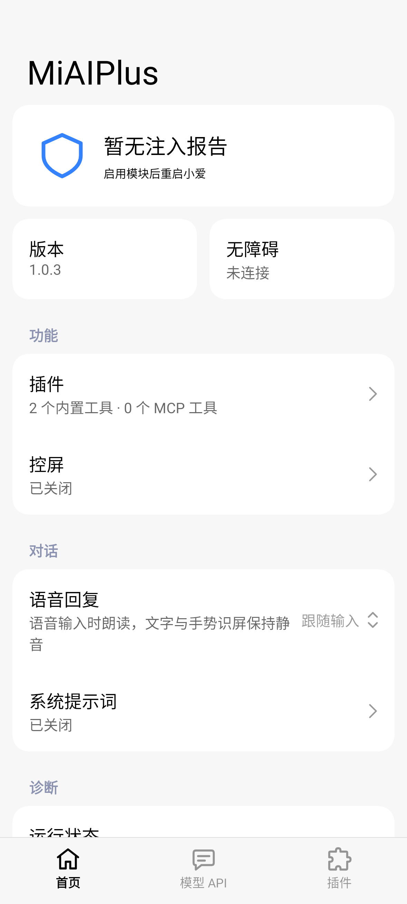 | 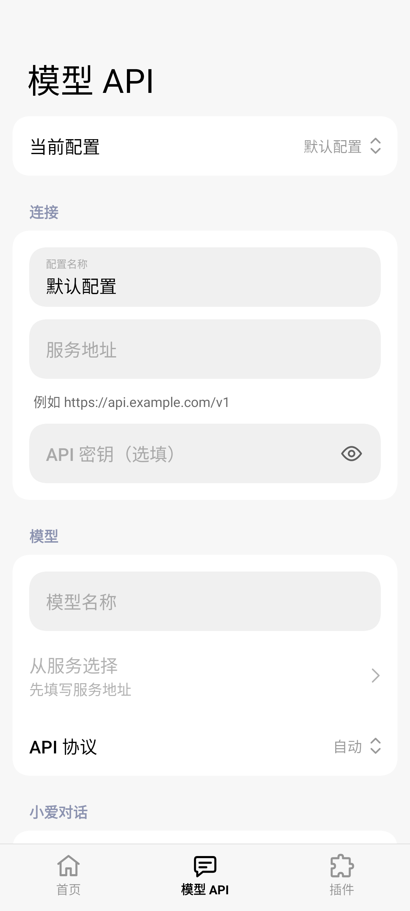 | 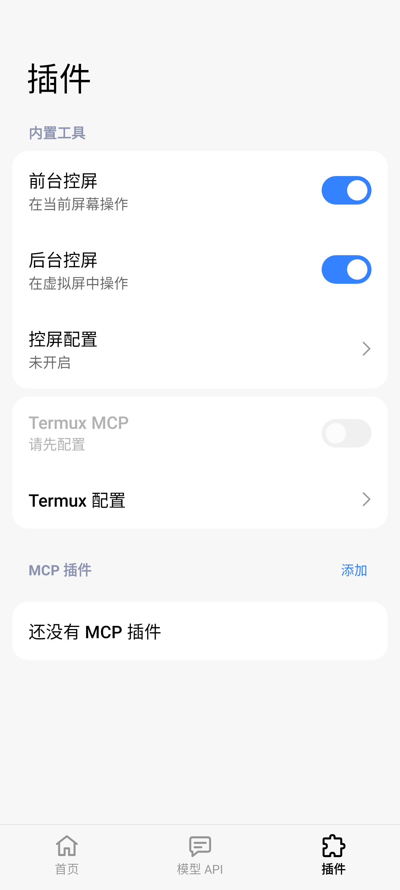 |

| 深色首页 | 深色插件 | 控屏配置（二级页） |
| --- | --- | --- |
| 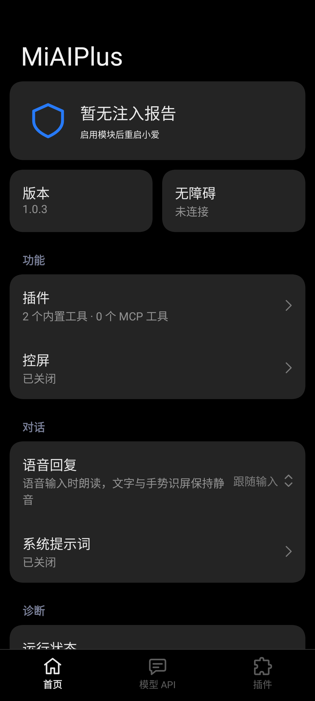 | 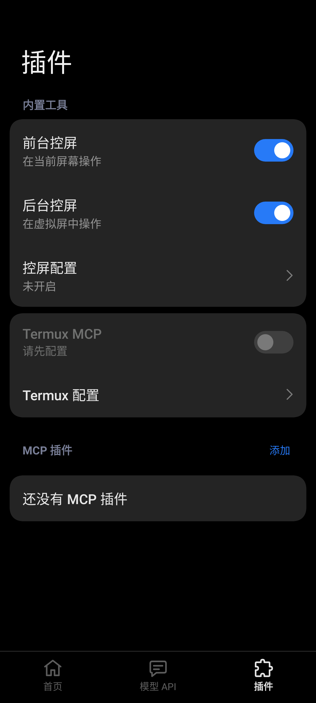 | 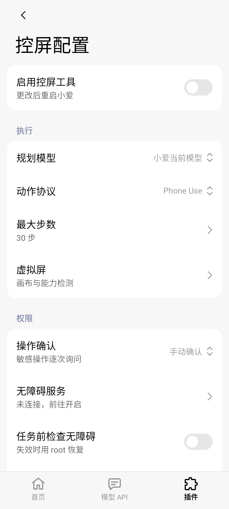 |

| Termux 配置 | Termux 配置（深色、1.5 倍字号） |
| --- | --- |
| 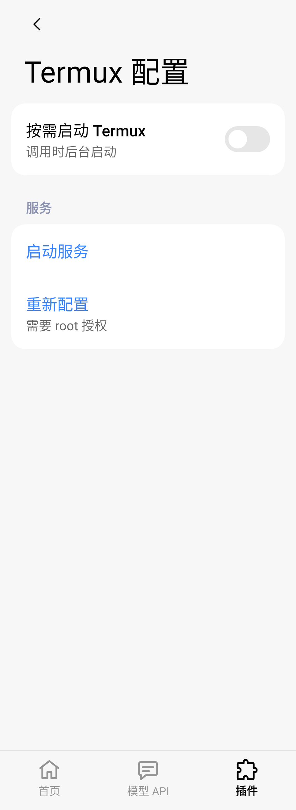 | 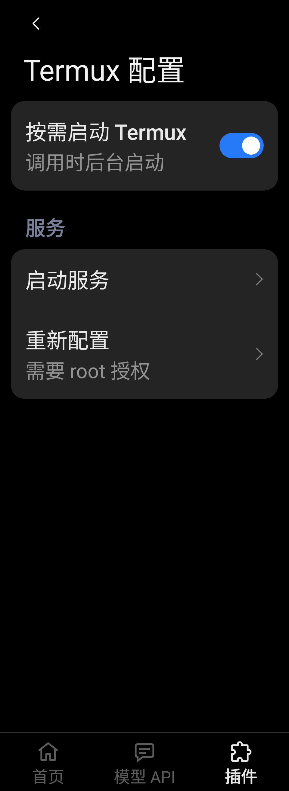 |

MCP 管理改为「列表 → 插件详情 → 编辑连接」，操作行与导航行采用不同样式。

| MCP 插件详情 | 运行状态 | 直接测试 |
| --- | --- | --- |
| 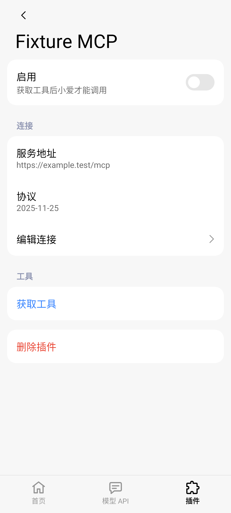 | 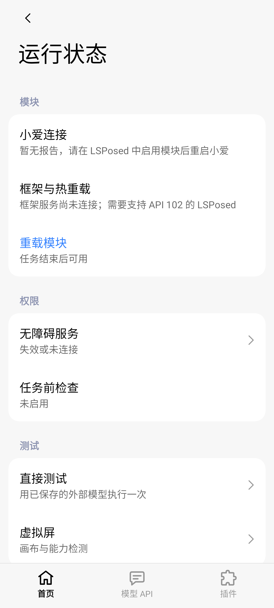 |  |

虚拟屏页将画布编辑收进「自定义分辨率」对话框；前置检查与能力检测保持手动触发：

| 虚拟屏 | 深色虚拟屏 |
| --- | --- |
| 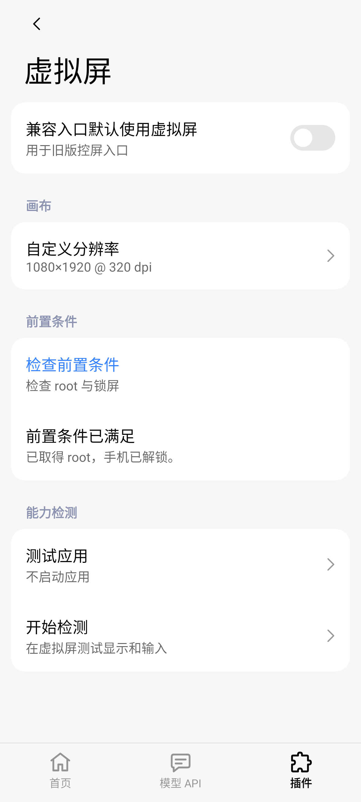 | 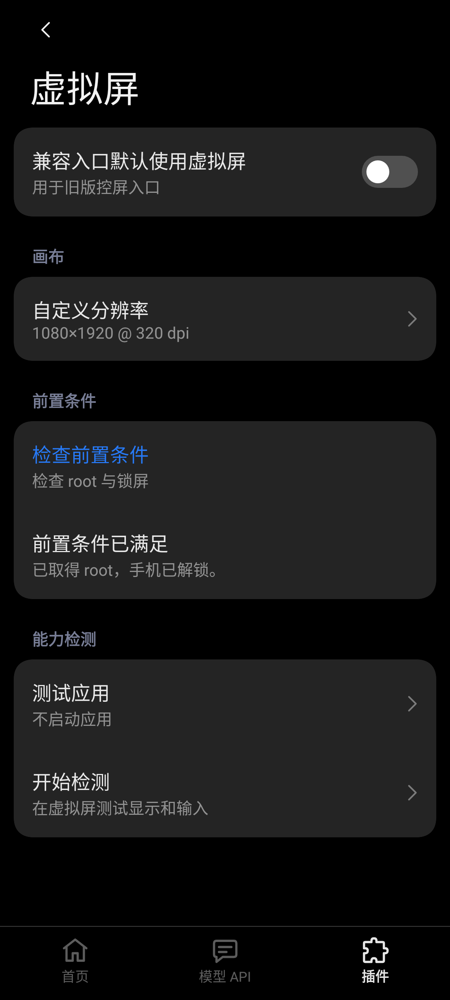 |

## 系统提示词页

首页「对话」分组下的「系统提示词」进入二级页，摘要显示 `已关闭`、`追加人设 · <名称>` 或 `替换提示词 · <名称>`。生效方式、人设切换和三个开关选中后立即生效；名称与正文通过「保存当前人设」保存。页面没有「还原／保存配置」底栏，切换或离开也不弹保存确认。

| 系统提示词 | 生效方式 | 人设方案 |
| --- | --- | --- |
| 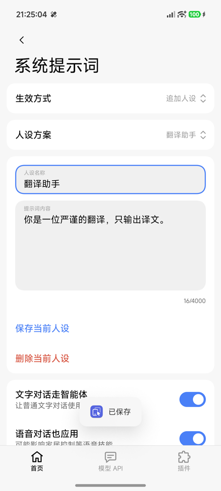 | 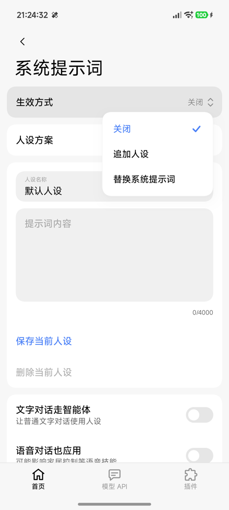 | 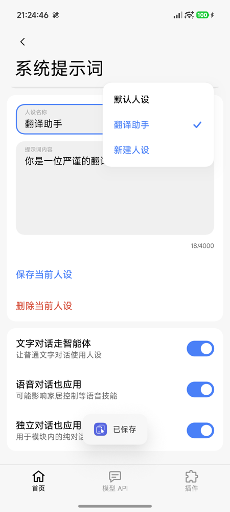 |

页面分四组：

- **生效方式**：`关闭`（默认）、`追加人设`、`替换系统提示词`，菜单选择立即保存。
- **人设方案**：点击后打开二级菜单，选择已有人设或蓝色的「新建人设」。新建时只填写名称，随后编辑空白正文；「保存当前人设」更新当前方案，「删除当前人设」删除当前方案。只剩一套时删除按钮禁用。
- **提示词内容**：最小六行，右下角显示 `n/4000`。超出上限时在输入处截断，不弹出提示。
- **三个开关**：`文字对话走智能体`、`语音对话也应用`、`独立对话也应用`，默认全关，切换立即保存。

未保存的名称和正文按人设保留在内存中，切换人设、离开再返回仍可继续编辑；只有「保存当前人设」会更新实际使用的正文。草稿不写 `SavedStateHandle`，进程结束后回到已保存内容。错误显示在列表上方。

交互修订与验证范围见 [本轮记录](validation/prompt-persona-ux-2026-11-14.md)；注入语义与隐私边界见 [初版记录](validation/prompt-persona-2026-11-14.md)。

## 设备专项入口

在已授权、无活动控屏任务的设备上使用独立测试应用，运行前确认配置可恢复。

```sh
./gradlew -PuiTestBuildType=preview :app:assemblePreviewAndroidTest
adb shell am instrument --user 0 -w -e virtual true \
  io.github.miaiplus.test/io.github.miaiplus.SettingsUiRunner
```

MIUI／HyperOS 设备上 `startActivitySync` 会被判为后台启动并被静默丢弃，表现为 `am instrument` 永久挂住、无输出、无截图。每次运行前必须先授予后台弹出界面 op：

```sh
adb shell cmd appops set io.github.miaiplus 10021 allow
```

其余陷阱（测试包必须用 `-PsettingsUiTests=true` 构建、残留 instrumentation、`uiautomator dump` 等不到空闲、不要手点验证流程）见 [设备测试环境陷阱](validation/prompt-persona-2026-11-14.md#设备测试环境陷阱务必先读)。

`-e virtualIdle true` 提供 45 秒页面空闲采样窗口，不启动 root 前置检查或能力检测。测试应用标签为「虚拟屏测试」，搜索使用包名 `virtualfixture`，避免误点同名输入框。日志专项入口与清空影响见 [详细日志](phone-use-logging.md#设备回归)。

## 插件页

「前台控屏／后台控屏」位于「内置工具」，各自启停并共用「控屏配置」入口；HTTP MCP 位于独立分组。

MCP 列表每项显示启用状态与工具数，点按进入该插件的详情页（标题超过 14 字时截断）；详情页提供启停、「编辑连接」、手动「获取工具／刷新工具」、逐个工具的说明与参数详情，以及删除。新增默认停用，保存配置不连接网络；显式刷新成功后可检查工具名称与说明，再确认启用。MCP 与控屏开关、外部模型配置独立。编辑框使用原小型下拉样式选择 `2025-11-25`（默认）或 `2025-06-18`（兼容），不提供任意版本输入；草稿选择随显式保存生效，取消不会改变已有配置。更改连接身份、认证或协议会清除旧目录，迟到刷新不能覆盖已更改的配置；握手响应不匹配所选版本即停止，不自动降级。服务器失败正文不显示为界面错误。

内置 Termux MCP 的主开关留在插件页，完成配置后可切换。「Termux 配置」收纳「按需启动 Termux」、「启动服务」和「自动配置／重新配置」；尚未安装 Termux 时，配置行显示安装提示。服务操作使用纵向 Miuix 设置行，返回后回到插件页。

「内置工具」分组还有「Eta Agent」开关，默认关闭，说明行按可用性显示：未安装、非官方签名、版本过旧、此版本不受支持，可用时为一句用途说明。仅在开关开启时显示第二个开关「终端和敏感工具」，打开时先弹出确认；它只允许模块向 Eta 申请终端与敏感工具，仍受 Eta 自身开关限制。执行契约见 [Eta 外部 Agent](eta-agent.md)。

插件页不提供批量停止调用按钮。当前没有可靠的原生 `Tool.onCancel` 调用归属，MCP 代理保持 `isStoppable=false`，不保证小爱原生停止按钮会取消远端。执行线程中断、超时或自身连接／启用／工具契约变化可中止本地等待；已发生的远端操作无法撤销。切换 Phone Use 或其他插件、仅修改本插件显示名称不会取消已接收的 MCP 调用。模块 worker 实际退出前仍拒绝热重载。

MCP 名称、地址和 Token 输入框在 OverlayDialog 外保留完整 `TextFieldValue`，同步光标、选区和输入法合成区；编辑状态不写 SavedState，取消重开时恢复已保存配置或空白草稿。

Bearer Token 默认遮挡，草稿只留在内存，配置保存在模块私有存储。启用时提示参数将发往所选服务器；HTTP 连接没有传输加密。支持 Streamable HTTP 工具子集，兼容协议实测见 [Termux 记录](validation/termux-mcp-2026-10-28.md)。

实现入口为 `PluginPage.kt`／`PluginState.kt`；支持范围、目录和超时限制见 [Plugin 平台](plugin-platform.md)。

### 语音回复策略

首页「对话」中的「语音回复」支持三种选择，保存后对新请求生效，无需重启小爱：

- **仅文字**：小爱回复不自动朗读。
- **跟随输入**（默认）：语音输入对应语音回复，文字输入与手势识屏对应文字回复。识屏页上主动点击麦克风发起的语音仍按语音输入处理；手势长按真正启动录音时也保留语音回复。
- **小爱默认**：关闭模块的回复策略覆盖，沿用小爱的原设置。

策略与控屏工具的启停分开。识屏按照实际识屏请求来源识别，不依赖前一轮是否语音，也不将所有长按手势都视作识屏。模块不写小爱原有的语音模式偏好。具体实现和本轮验证范围见 [架构](architecture.md) 与 [验证摘要](validation.md)。
