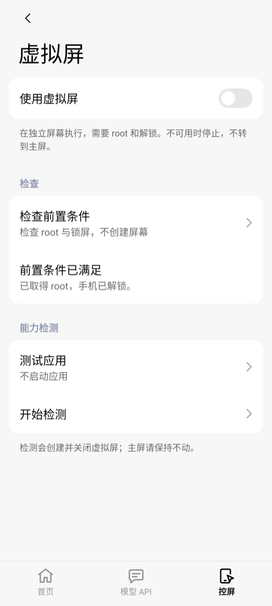
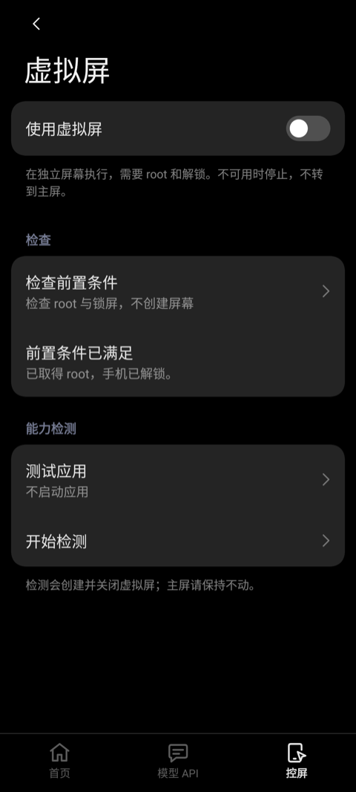

# 模块配置界面

界面在 `ui/miuix-settings` 分支开发，现与 main 工作区的最新后台虚拟屏源码完成集成。历史手机验证与本轮本地验证分别记录。

## 页面

底栏固定按「首页 → 模型 API → 控屏」排列，使用 Miuix 原生 `NavigationBar` / `NavigationBarItem`。

| 页面 | 内容 | 保存方式 |
| --- | --- | --- |
| 首页 | KernelSU 式状态卡、模块版本、无障碍状态、当前控屏配置、对话闲置时长 | 状态只读；对话时长即时保存 |
| 模型 API | 配置切换、地址与密钥、模型列表、API 协议、外部对话开关 | API 配置显式保存；切页时可保存、放弃或取消 |
| 控屏 | 启用开关、规划模型、动作协议、最大步数、虚拟屏入口、权限 | 即时保存；步数限制 1–200，默认 30 |
| 虚拟屏 | 执行开关、画布分辨率、前置检查、测试应用、逐项能力检测 | 控屏页进入；画布显式保存，检查与检测手动触发 |
| 运行状态 | 注入报告、框架与热重载、权限、虚拟屏与直接测试入口 | 首页进入 |
| 直接测试 | 外部模型控屏与纯对话 | 运行状态页进入；只用已保存配置 |

首页的注入结果来自持久化报告，注明「上次」并显示报告时间，不将历史报告或控屏开关显示为实时连接。无报告时提示启用模块并重启小爱。

首页「对话 → 自动新建对话」配置距离上次操作的闲置时长，默认 15 分钟，支持 1–1440 分钟，0 表示关闭。全屏和浮窗共用同一规则：时长内唤醒继续同一对话，超过时长后再次唤醒新建对话。该配置独立于模型服务与控屏设置。

二级页进入和返回有 240 ms 的短距离滑动与淡入淡出，仅改变绘制层的位移和透明度，不使用整页尺寸过渡或 lookahead。结束即释放旧页面；退出页面不接收点击或无障碍焦点。底栏跨标签切换直接完成，模型表单按可见分组懒加载，各页保留滚动位置，系统返回逐级退回。首页和表单无定时刷新；诊断页前台每 3.5 秒更新。普通切页不再重复刷新诊断，返回前台时刷新完整状态；未保存标记仅在干净/已修改之间变化时通知导航与保存栏。

控件、圆角、间距、字号和颜色沿用 Miuix 0.9.4，跟随系统深浅色，内容最大宽度 680 dp。删去重复说明，保留保存边界、数据发送和执行条件等必要提示。

API 协议、当前配置、规划模型、动作协议和测试类型等小型下拉选择窗口使用 Miuix `OverlayListPopup`，关闭 `enableWindowDim`，保留选中标记、定位、动画和外部点击关闭。确认／编辑对话框继续使用原有样式。开启「小爱对话 → 使用外部模型」会将规划模型保存为「小爱当前模型」并禁用该选择，控屏跟随小爱当前使用的全局模型；关闭后可重新手动选择独立外部规划。

## 虚拟屏

「控屏 → 虚拟屏」管理原有 `backgroundDisplay` 配置，首页同步显示执行屏幕。开关影响新任务，进行中的任务保持原屏幕。关闭时沿用主屏；开启后由已有后端执行虚拟屏任务，不可用时停止。

- 画布可自定义宽、高和密度，分别限制为 320–4096 像素、80–1000 dpi；默认保持 1080×1920@320。可读取本机当前物理屏的完整像素尺寸与密度并填入编辑框，点击「保存」后应用于后续新建的虚拟屏，能力探测也使用同一画布；进行中的会话保持原参数。

- 前置检查调用 `background_display_status`，只查询 root 与锁屏条件。
- 能力检测调用 `background_display_probe`。可按名称或包名搜索测试应用，也可不启动应用。确认后短暂创建虚拟屏、发送测试输入并回收。
- 结果按创建、截图、启动、无障碍树、触控、按键通路、主屏焦点、回收分别显示通过、未通过或未验证。点击查看后端详情；缺失与未知结果按未验证处理，不采信汇总数字为成功。
- 两个检查都先确认没有控屏任务或准备工作，且不随页面进入、状态刷新、重建或返回重复执行。应用列表懒加载，IPC 与结果解析在工作线程运行。

前端使用现有 IPC。虚拟屏直接测试保持设置页在主屏可见；主屏控屏测试先隐藏设置窗口以显示目标应用，纯对话保持界面。检查或能力检测进行中拒绝启动直接测试。当前后端不提供预览/接管接口，因此页面不显示这些操作。旧后端返回不支持时显示需更新。

## 配置与兼容

草稿在 ViewModel 中保留，不把密钥写入 SavedState。密钥默认遮挡，离开页面或切换配置后重新遮挡，配置保存在应用私有存储。2026-10-18 起模块设置窗口不再设置 `FLAG_SECURE`，设置页与继承窗口策略的弹窗允许用户截图；用户主动显示的密钥也可能进入截图。服务地址、密钥、模型默认仍为空。未保存时，外部对话开关暂不可更改，避免将草稿与已保存服务混用。

沿用 `Config`、`EndpointProfiles`、`AccessibilityGuard`、`HotReload` 和 `BridgeProvider`；集成保留 main 的最新 Hook、执行器及后台屏实现。开启外部模型前验证已保存配置；保留对话数据发送确认。前置检查不创建屏幕；能力检测会实际创建并销毁屏幕。两者均不能替代真实模型任务验证。

## 验证

2026-10-18：最新 Debug／AndroidTest 在 Xiaomi 25019PNF3C、API 37 上通过设置页专项。API 协议下拉打开前后，菜单外非黑色区域像素保持一致；全局外部模型开启后，规划模型持久化为原生且实际触摸不展开，关闭后可重新选择。两张实机截图已人工核对；测试结束验证原配置恢复，未发起模型请求。完整本地与原生网络测试见 [验证记录](validation.md)。

`SettingsUiTest` 在 Robolectric Android 35 上检查底栏顺序、草稿保存/放弃/取消、二级页进退过渡与父页面、历史注入状态、步数边界、画布编辑保存与本机分辨率填充、模型列表懒加载以及后台屏按需查询。`SettingsStateDisplayGeometryTest` 检查画布持久化、边界拒绝和默认屏几何读取。截图位于 `app/build/outputs/ui-screenshots/`，只使用默认值和测试数据。

前一轮 96 项 JVM / Robolectric 测试通过，包含应用搜索与选择；Debug、AndroidTest 与优化 Preview APK 构建通过。Preview 本地构建显式跳过存在基线错误的 `lintVitalPreview`；完整 Lint 单独执行并保留失败结果。实机 UI 专项通过，未重启小爱或发起模型请求。本次与历史性能数据分别记录于 [性能记录](settings-performance.md)。

上述旧前端基线当时被 `helper/DisplayHelper.java` 的三处错误阻塞；不能代表最新集成源码的检查结果。

## 最新后端集成验证（2026-10-17）

在隔离工作区将完整前端与 main 当时的全部后端改动联合编译，覆盖 `NativeSession` / `PageGuard`、`RunState`、`FrameStore`、`InteractionUi`、`XiaoAiHook` 及后台屏五个文件，避免只同步五个后台屏文件而遗漏会话与生命周期修复。前端提交不收录其他作者未提交的后端改动；合并工作区继续保留它们。

103 项 JVM/Robolectric 测试通过，含新增的虚拟屏、主屏、纯对话三类直接测试界面交接。Debug/Release Lint、Debug/Release APK、Debug AndroidTest APK 均通过，未跳过 Lint。本轮没有安装设备、重启小爱、运行 root 探针或调用模型；下方实机结论属于历史验证。前端能力探针仍如实显示其未测的无障碍树，不将独立设备报告的结果填入本次探针。

以下截图为本轮 Robolectric fixture 渲染，只含测试状态：

| 虚拟屏 | 深色虚拟屏 |
| --- | --- |
|  |  |

## 截图

| 首页 | 模型 API | 控屏 |
| --- | --- | --- |
|  |  |  |


| 虚拟屏 | 深色虚拟屏 |
| --- | --- |
|  |  |

运行虚拟屏专项（须有已授权、无活动控屏任务的设备及独立测试应用）：

```sh
./gradlew -PuiTestBuildType=preview :app:assemblePreviewAndroidTest
adb shell am instrument --user 0 -w -e virtual true \
  io.github.miaiplus.test/io.github.miaiplus.SettingsUiRunner
```

`-e virtualIdle true` 提供 45 秒页面空闲采样窗口，不启动 root 前置检查或能力检测。测试应用标签为「虚拟屏测试」，搜索使用包名 `virtualfixture`，避免误点同名输入框。

## 实机验证（2026-10-16）

设备为 Xiaomi 25019PNF3C / Android API 37 / HyperOS 4，有线连接、横屏。先推送 PR，再安装优化 Preview 前端测试包。为保留手机尚未同步到远程的后端，测试包使用已安装 APK 的原有后端类及 record 支持类，214 个类的完整 smali 逐一比对一致；不将后端快照提交到分支。初次本地重打包漏带 record 支持类，导致 helper 退出；补齐依赖后，通过页面完成两轮实际能力检测。

实机 Runner 验证开关保存与恢复、root/解锁检查、应用搜索与选择、确认/取消、实际能力检测、详情、重建保留及返回控屏/首页。

| 检测项 | 本机结果 |
| --- | --- |
| 创建独立屏幕、截图、启动测试应用 | 通过 |
| 定向触控、按键通路 | 通过 |
| 主屏焦点隔离、关闭与回收 | 通过 |
| 无障碍树 | 未验证：后端探针不测此项 |

使用无权限、无网络、无个人数据的独立测试应用。按键项只证明定向 BACK 与画面变化，不能据此宣称中文输入可用；没有执行真实模型控屏任务。原配置对比仅 `hook_at` 注入报告时间变化，无障碍保持测试前的未连接状态；结束后无模块虚拟屏或 helper 残留，并移除本轮测试应用。
