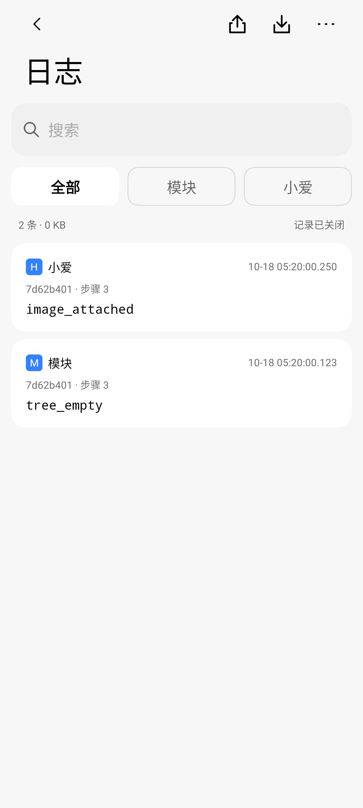
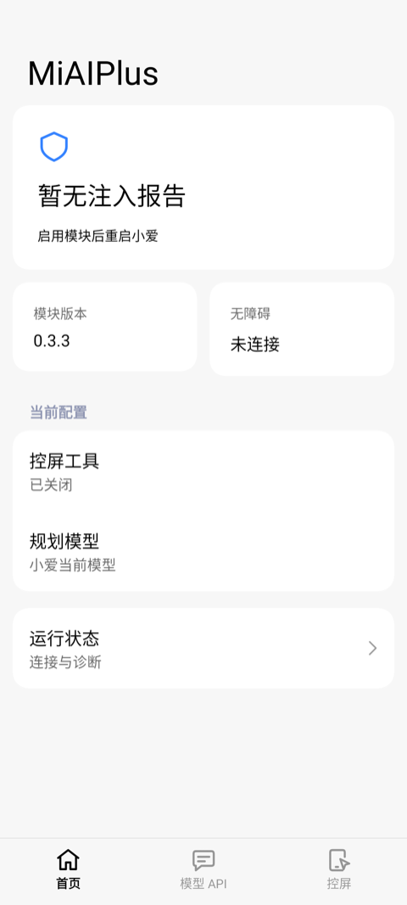
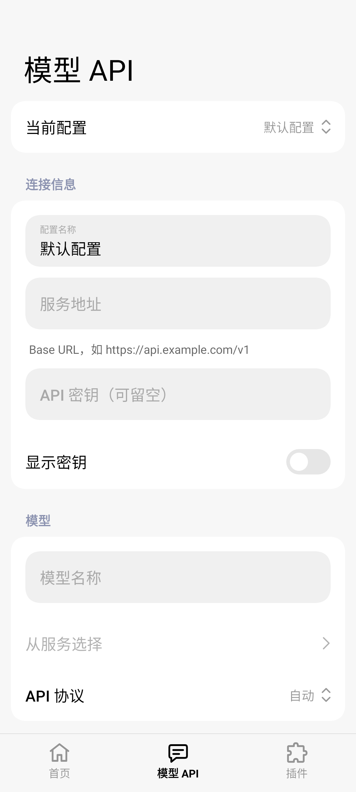
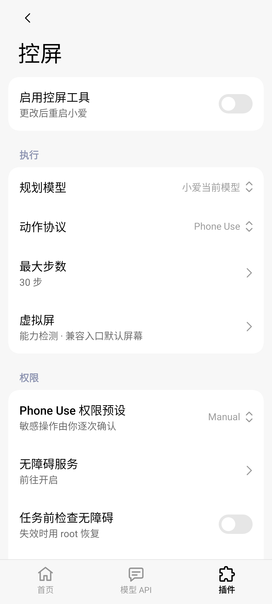
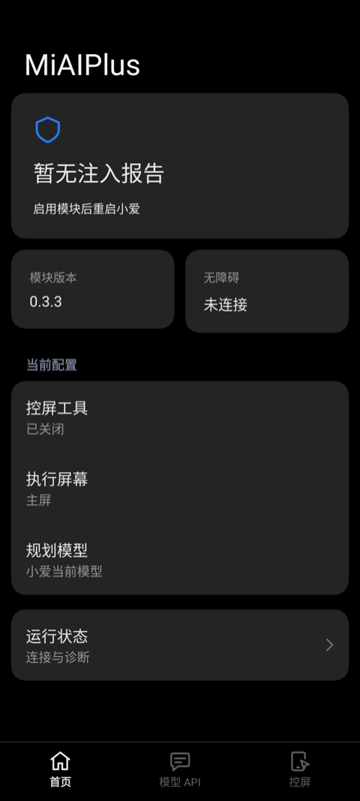
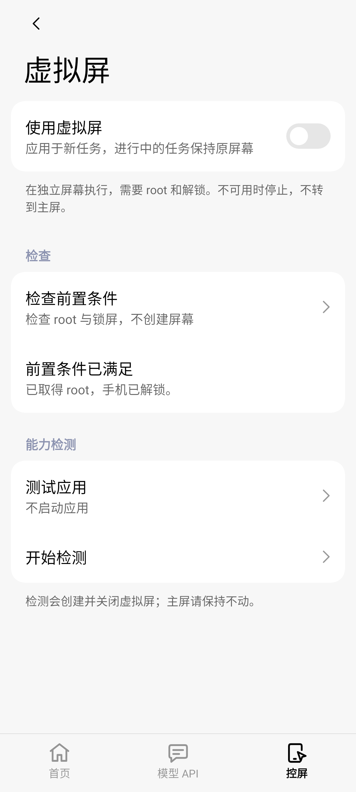
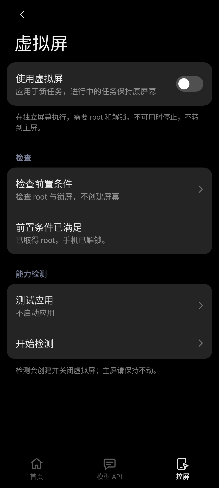

# 模块配置界面

设置界面使用 Compose 与 Miuix，连接模块现有配置、Hook 和后台虚拟屏后端。历史验证按日期记录，当前版本的检查结果以 [验证记录](validation.md) 为准。

「首页 → 日志 → 更多」提供默认关闭的「详细日志」开关，同时覆盖前台和虚拟屏，保存后无需重启。原「控屏 → 诊断」开关保持同步。可直接查看、搜索、按来源筛选、展开复制，保存或分享 ZIP，并确认清空；记录范围、容量与覆盖限制见 [详细日志](phone-use-logging.md)。

## 页面

底栏固定按「首页 → 模型 API → 控屏」排列，使用 Miuix 原生 `NavigationBar` / `NavigationBarItem`。

模型 API 列表的滚动区域延伸到底栏或未保存配置操作栏上沿；24 dp 尾部留白放在列表内容内，随末项滚动，避免底栏上方固定空出一条并提前截断卡片。

| 页面 | 内容 | 保存方式 |
| --- | --- | --- |
| 首页 | KernelSU 式状态卡、模块版本、无障碍状态、当前控屏配置、对话闲置时长 | 状态只读；对话时长即时保存 |
| 日志 | 详细日志开关、自动刷新、搜索／来源筛选、记录详情、保存／分享 ZIP、清空 | 首页进入；顶部图标保存／分享，更多菜单管理开关／刷新／清空 |
| 模型 API | 配置切换、地址与密钥、模型列表、API 协议、外部对话开关 | API 配置显式保存；切页时可保存、放弃或取消 |
| 控屏 | 启用开关、规划模型、动作协议、最大步数、虚拟屏入口、权限 | 即时保存；步数限制 1–200，默认 30 |
| 虚拟屏 | 执行开关、画布分辨率、前置检查、测试应用、逐项能力检测 | 控屏页进入；画布显式保存，检查与检测手动触发 |
| 运行状态 | 注入报告、框架与热重载、权限、虚拟屏与直接测试入口 | 首页进入 |
| 直接测试 | 外部模型控屏与纯对话 | 运行状态页进入；只用已保存配置 |

首页的注入结果来自持久化报告，注明「上次」并显示报告时间，不将历史报告或控屏开关显示为实时连接。无报告时提示启用模块并重启小爱。

首页「版本／无障碍」两张概览卡复用与下方设置项相同的 Miuix `BasicComponent`：17 sp 中等字重标题、14 sp 次要色说明及 16 dp 内边距，统一字号层级和对齐，随系统字体缩放。两卡按本行所需高度等高，避免中英文排版造成卡片底边不齐。2026-10-28 的本地构建与实机范围见 [首页字号记录](validation/settings-home-typography-2026-10-28.md)。

日志页参照实机 LSPosed 的工具栏、搜索、分类和紧凑日志卡片布局；日志页隐藏底部导航，通过左上角或系统返回首页。详细日志与自动刷新开关收进「更多」，正文仅显示条数、大小和记录状态，丢弃／写入失败计数只在非零时提示；说明与容量边界保留在文档。使用有界懒列表，显示筛选后最近 500 条，导出包含全部保留记录；读取与压缩在后台线程执行。下图是合成元数据的 Robolectric 渲染：

| 浅色 | 深色 |
| --- | --- |
|  |  |

首页「对话 → 自动新建对话」配置会话超时时长，默认 15 分钟，支持 1–1440 分钟，0 表示关闭。全屏和浮窗共用同一规则：每次打开都重新开始计时，即使没有输入；用户操作也更新计时，模型回复与工具结果不延长时间。时长内再次打开继续同一对话，超过时长则在下次打开时新建，不在使用过程中突然切换。显式历史选择与完成通知返回优先。该配置独立于模型服务与控屏设置。修复与验证边界见 [会话生命周期记录](validation/conversation-lifecycle-2026-10-19.md)。

二级页进入和返回有 240 ms 的短距离滑动与淡入淡出，仅改变绘制层的位移和透明度，不使用整页尺寸过渡或 lookahead。结束即释放旧页面；退出页面不接收点击或无障碍焦点。底栏跨标签切换使用 220 ms 的淡入和 24 dp 水平滑入，方向跟随底栏顺序；只保留新页面，连续点击以最后选择为准，重复点击当前标签不重播。系统关闭动画时跟随关闭。模型表单按可见分组懒加载，各页保留滚动位置，系统返回逐级退回。首页和表单无定时刷新；运行状态页前台每 3.5 秒更新，日志页可关闭的自动刷新每 2 秒更新，均在退出页面或后台时停止。普通切页不再重复刷新诊断，返回前台时刷新完整状态；未保存标记仅在干净/已修改之间变化时通知导航与保存栏。

控件、圆角、间距、字号和颜色沿用 Miuix 0.9.4，跟随系统深浅色，内容最大宽度 680 dp。删去重复说明，保留保存边界、数据发送和执行条件等必要提示。

API 协议、当前配置、规划模型、动作协议和测试类型等小型下拉选择窗口使用 Miuix `OverlayListPopup`，关闭 `enableWindowDim`，保留选中标记、定位、动画和外部点击关闭。确认／编辑对话框继续使用原有样式。开启「小爱对话 → 使用外部模型」会将规划模型保存为「小爱当前模型」并禁用该选择，控屏跟随小爱当前使用的全局模型；关闭后可重新手动选择独立外部规划。

「控屏 → 权限 → Phone Use 权限预设」提供 Manual／Auto／YOLO，默认 Manual。Manual 的敏感操作由用户逐次同意；Auto 由模型自动审计，无法确定时升级为用户确认；YOLO 除严重安全问题外自动同意。锁屏、安全窗口、密码和验证码等硬限制不受预设影响。配置以 `phoneUsePermissionMode=manual|auto|yolo` 保存在应用私有存储，保存后对新任务生效；缺失、未知或类型错误的旧值均按 Manual 处理。该选择不授予 Android 系统权限，也不改变当前应用使用授权。

## 虚拟屏

「控屏 → 虚拟屏」管理兼容入口的默认屏幕偏好 `backgroundDisplay`，默认关闭，首页同步显示该配置。开关影响后续通过兼容入口发起的新任务，进行中的任务保持原屏幕；关闭选用主屏，开启选用虚拟屏。原生 `miaiplus_phone_use`／`miaiplus_background_phone_use` 分别选择前台／后台，不受此默认偏好影响。后台不可用时停止，不静默回退物理屏。

- 画布可自定义宽、高和密度，分别限制为 320–4096 像素、80–1000 dpi；默认保持 1080×1920@320。可读取本机当前物理屏的完整像素尺寸与密度并填入编辑框，点击「保存」后应用于后续新建的虚拟屏，能力探测也使用同一画布；进行中的会话保持原参数。

- 前置检查调用 `background_display_status`，只查询 root 与锁屏条件。
- 能力检测调用 `background_display_probe`。可按名称或包名搜索测试应用，也可不启动应用。确认后短暂创建虚拟屏、发送测试输入并回收。
- 结果按创建、截图、启动、无障碍树、触控、按键通路、主屏焦点、回收分别显示通过、未通过或未验证。点击查看后端详情；缺失与未知结果按未验证处理，不采信汇总数字为成功。
- 两个检查都先确认没有控屏任务或准备工作，且不随页面进入、状态刷新、重建或返回重复执行。应用列表懒加载，IPC 与结果解析在工作线程运行。

前端使用现有 IPC。虚拟屏直接测试保持设置页在主屏可见；主屏控屏测试先隐藏设置窗口以显示目标应用，纯对话保持界面。检查或能力检测进行中拒绝启动直接测试。当前后端不提供预览/接管接口，因此页面不显示这些操作。旧后端返回不支持时显示需更新。

## 配置与兼容

草稿在 ViewModel 中保留，不把密钥写入 SavedState。密钥默认遮挡，离开页面或切换配置后重新遮挡，配置保存在应用私有存储。2026-10-18 起模块设置窗口不再设置 `FLAG_SECURE`，设置页与继承窗口策略的弹窗允许用户截图；用户主动显示的密钥也可能进入截图。服务地址、密钥、模型默认仍为空。未保存时，外部对话开关暂不可更改，避免将草稿与已保存服务混用。

设置通过 `Config`、`EndpointProfiles`、`AccessibilityGuard`、`HotReload` 和 `BridgeProvider` 连接配置与后端。开启外部模型前验证已保存配置；保留对话数据发送确认。前置检查不创建屏幕；能力检测会实际创建并销毁屏幕。两者均不能替代真实模型任务验证。

## 维护与验证

行为说明以当前源码为准；已执行检查及 mock／实机／真实模型覆盖范围集中记录在 [验证记录](validation.md)，性能采样见 [性能记录](settings-performance.md)。此处不重复维护各轮测试总数、构建状态和设备操作流水；旧截图、局部探针或历史混合后端测试包不能证明当前完整版本已通过。

| 维护入口 | 职责 |
| --- | --- |
| `MainActivity.kt` / `SettingsState.kt` | 导航、表单草稿、配置保存与状态刷新 |
| `VirtualScreenState.kt` | 虚拟屏画布、按需检查和能力探测 |
| `DiagnosticLogPage.kt` / `DiagnosticLogState.kt` | 日志筛选、详情、前台刷新和导出交互 |
| `DiagnosticLogStore.java` / `PhoneUseLog.java` | 私有轮转存储、双来源采集与诊断上下文 |

`SettingsUiTest` 的 Robolectric 测试覆盖导航、草稿、配置、权限预设、日志筛选／详情／清空与直接测试交接；`SettingsStateDisplayGeometryTest` 覆盖画布持久化、边界和本机几何读取；`DiagnosticLogStoreTest` 覆盖轮转、存储失败、队列容量及 ZIP 白名单。测试存在不等于本轮已运行，设备专项也不能替代真实模型任务验证。

## 截图

首页浅色／深色图更新于 2026-10-28，使用无报告、未连接的合成配置进行 Robolectric 渲染，不包含个人设备配置。

| 首页 | 模型 API | 控屏 |
| --- | --- | --- |
|  |  |  |



以下虚拟屏图为历史 Robolectric fixture，未展示后续新增的全部设置：

| 虚拟屏 | 深色虚拟屏 |
| --- | --- |
|  |  |

## 设备专项入口

以下命令仅供已授权、无活动控屏任务的测试设备使用；文档不授予设备操作权限。使用独立测试应用，运行前确认配置可恢复。

```sh
./gradlew -PuiTestBuildType=preview :app:assemblePreviewAndroidTest
adb shell am instrument --user 0 -w -e virtual true \
  io.github.miaiplus.test/io.github.miaiplus.SettingsUiRunner
```

`-e virtualIdle true` 提供 45 秒页面空闲采样窗口，不启动 root 前置检查或能力检测。测试应用标签为「虚拟屏测试」，搜索使用包名 `virtualfixture`，避免误点同名输入框。日志专项入口与清空影响见 [详细日志](phone-use-logging.md#设备回归)。
