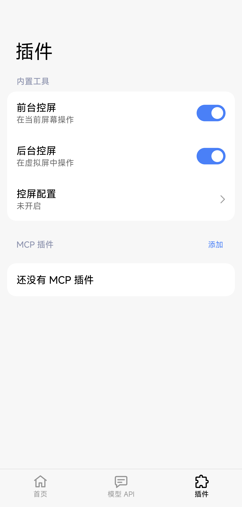

# MCP 添加按钮与 v1.0.2-preview

日期：2026-10-29。基于 main `210d0f5`，只调整插件分组操作布局、README、版本与相应检查，不改动 Phone Use 执行逻辑。

## 修复

原按钮继承普通设置按钮的尺寸和填充，作为分组标题操作时显得过大，且挤到下方卡片边缘。MCP 标题改用与「内置工具」一致的 SmallTitle；「添加」改为透明文字按钮，统一小字号，保持 48 dp 点击高度。标题与按钮垂直居中，左右文字对齐卡片内容边缘，并与下方卡片留出 8 dp。

## 本地

```sh
./gradlew :app:testDebugUnitTest :app:lintDebug :app:lintRelease \
  :app:assembleDebug :app:assembleRelease :app:assemblePreview \
  :app:assembleDebugAndroidTest
./gradlew -PuiTestBuildType=preview :app:assemblePreview :app:assemblePreviewAndroidTest
python3 scripts/test_accessibility_guard.py
```

525 项 JVM／Robolectric 与 7 项 guard 测试通过；Debug／Release 完整 Lint 零错误，各构建通过。新增 320 dp 窄屏回归：标题和按钮中心相等、互不重叠、不覆盖下方卡片，并可点击进入编辑。浅色、深色渲染另作视觉检查。

## 实机

在已授权的 Xiaomi API 37 设备安装版本码 16 的优化 Preview。`SettingsUiRunner -e plugins true` 通过，包含标题／按钮中心误差不超过 2 像素、横向不重叠、添加、MCP 草稿重建和取消、插件／控屏／虚拟屏导航与返回、模型未保存确认。未发起模型请求或虚拟屏探测。

原设置逐项恢复并确认相等；原先安装的 instrumentation APK 已恢复并校验 SHA256。无障碍服务和 ADB reverse 列表保持不变。手机保留本次优化 Preview，其 APK 与本地产物一致。

Preview SHA256：`ff0834c8aa23ded269ff02966f061e79fa71b2264b00cab200ff26977157c3c7`。

实机截图使用合成配置，裁去系统状态栏和手势区域：



## 发布流程

版本为 `1.0.2-preview`，versionCode 为 16。README 按当前入口重写，说明控屏启用、MCP 配置、模型设置与日志使用。

推送 main 和匹配版本 tag 后，由 Signed Release 工作流重新测试、Lint、构建，并在 release 环境签名；不导出签名私钥。发布前核对签名与旧正式包一致、APK 包名和版本、校验清单及源码 ZIP 与 tag 的对应关系。工作流生成的草稿经核验后公开为预发布，状态与产物以 [v1.0.2-preview](https://github.com/astoHu1/MiAIPlus/releases/tag/v1.0.2-preview) 为准。
