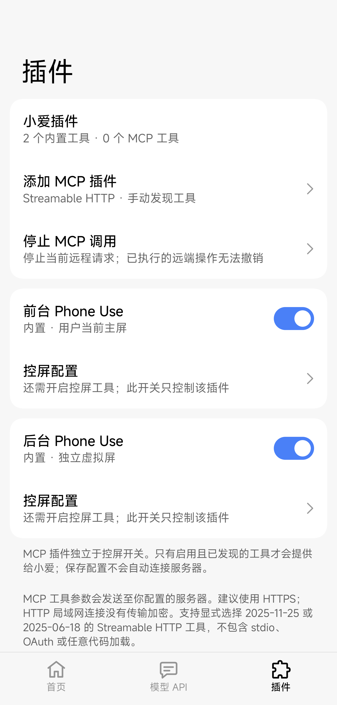

# 插件底栏入口

2026-10-28，基于 `4078690` 的当前工作树。底栏从「首页／模型 API／控屏」改为「首页／模型 API／插件」，使用与现有导航图标同线宽的拼图图标。插件页成为一级页面，顶部不显示返回按钮；首页保留插件概览快捷入口。

原控屏页通过内置 Phone Use 的「控屏配置」进入，虚拟屏继续位于控屏页下。两页均保持插件标签选中，返回按「虚拟屏 → 控屏 → 插件 → 首页」逐级处理。底栏切页方向、二级页面动画、模型 API 草稿保存确认及配置持久化沿用现有机制。没有调整插件启停、MCP 协议、控屏权限或执行后端。

## 首轮本地检查

使用 JDK 25、项目本地 SDK 和 Gradle 缓存执行：

```sh
./gradlew :app:testDebugUnitTest --tests io.github.miaiplus.SettingsUiTest :app:lintDebug :app:assembleDebug :app:assembleDebugAndroidTest
./gradlew :app:testDebugUnitTest :app:lintDebug :app:lintRelease :app:assembleDebug :app:assembleRelease :app:assembleDebugAndroidTest
```

- 设置页定向回归 27 项通过。最终全量 JVM／Robolectric 回归 524 项通过，无失败、错误或跳过；该数字来自当前整个工作树，包含此前已有的观察与日志改动。
- Debug／Release 完整 Lint 通过，均无错误；分别保留 37／26 项 Warning，各 1 项 Hint。Debug、Release 和 Debug AndroidTest 构建通过。
- 设置页回归覆盖底栏顺序、插件一级页、控屏与虚拟屏的标签归属、工具栏／系统返回、页面重建、首页快捷入口、深浅色、双向切页与中断动画、模型 API 草稿保存及滚动恢复。
- 现有插件 UI 回归改为从底栏进入，继续检查内置项、MCP 草稿、凭证遮挡、启用确认、协议选择及工具参数查看；首次全量回归发现旧测试仍要求首页标签选中，更新为插件标签后完整重跑通过。
- 更新设备设置 runner 的控屏入口与底栏性能采样路径，并通过 AndroidTest 编译；未执行设备 runner。
- 人工核对本轮合成配置的首页、插件深浅色和控屏二级页渲染；截图见 [设置界面](../settings-ui.md#截图)。
- `git diff --check` 通过。

构建日志位于本机临时文件 `/tmp/miaiplus-plugins-tab-validation.log` 和 `/tmp/miaiplus-plugins-tab-full-validation.log`。

## 首轮验证边界

上述为首轮本地检查，当时未安装或操作手机，未启动模型请求、MCP 网络调用、控屏任务或后台显示探针；没有重做设备性能、宿主 Hook 或真实模型验收。截图来自 Robolectric 合成配置，不含个人设备数据。后续用户授权将导航改动单独提交至 Pluginify，并在已连接设备上执行设置页回归；结果另行追加，不追溯为首轮已经验证。


## 后续分支确认与实机回归

用户随后授权确认推送分支并测试已连接手机。2026-10-28 夜间完成回归，2026-10-29 收尾；这一节是新增设备证据，不追溯为首轮已通过实机。

### 分支与构建身份

- 开始时当前分支已为 Pluginify，底栏修改尚未提交或推送；远端 main 为 8e9ff66，其提交是另一个 Phone Use 优化功能，本次导航修改不在其中，无需回滚 main。
- 导航与文档提交 09725aa 已显式推送到 refs/heads/Pluginify。测试器触摸路径修正与 Compose 回归为 9e14f07，同样推送到 Pluginify，没有修改生产导航逻辑。
- 从已推送提交导出独立源码快照构建，未混入共享工作树的未提交 Phone Use 观察／日志改动。最终 506 项 JVM／Robolectric 全部通过，无失败、错误或跳过；Debug／Release 完整 Lint 均无错误，分别 34／23 项 Warning，各 1 项 Hint。
- 独立源码的 Debug、Release、优化且开发签名的 Preview 和 Preview AndroidTest 构建通过。JVM／普通构建与 -PuiTestBuildType=preview 的 instrumentation 构建分开执行。
- 设备保留安装包是 io.github.miaiplus.pluginify 的优化 Preview，本地与设备 base.apk 摘要一致；主线 io.github.miaiplus 安装路径未变。

Preview APK SHA-256：

    6fca21373d1a43913706acdebb85651ca25e3bddb42dacdb18c6e5e56fba92b9

最终 Preview AndroidTest SHA-256：

    7a275d2c4d79438c065dcb51928f62b5dff4fff94766476f16000d17447df7c8

### 设备结果

设备为 Xiaomi 15 Ultra、Android API 37，owner 用户 0，实际界面为浅色。执行设置页专项：

    adb shell am instrument --user 0 -w -e plugins true io.github.miaiplus.pluginify.test/io.github.miaiplus.SettingsUiRunner

instrumentation 启动后，通过 adb 显式打开同包 MainActivity，配合本机的 Activity 启动等待；未重启小爱或切换 LSPosed 模块。

- 插件底栏入口、一级页无返回按钮、控屏／虚拟屏保持插件标签选中均通过。
- 虚拟屏重建后仍在原页；工具栏返回控屏、系统返回插件、再返回首页通过。
- 控屏子页真实触摸已选中的插件标签可返回根页，模型 API 草稿的取消／放弃确认通过。
- 结束时校验没有模型任务，未触发虚拟屏前置检查或能力探测。
- runner 在 finally 中逐项恢复并比较原偏好，输出 Original settings restored and verified；无障碍服务列表、ADB reverse 和主线 APK 安装路径均与开始时完全一致。
- 移除本轮安装的独立测试 APK，保留优化 Preview；未改 root 授权、LSPosed 作用域或主线配置。

首轮与第二轮均在所选标签的点击步骤失败，原配置都已恢复。Android 无障碍未给已选中的 Compose Tab 提供 ACTION_CLICK，原测试器因此无法执行该操作。改为对标签注入真实触摸后，完整专项返回 PASS。Compose 回归额外验证了从控屏、虚拟屏分别触摸当前标签回到插件根页，无需修改生产导航代码。

实机图使用本轮合成配置，已裁去系统状态栏和手势栏：



本轮未运行真实模型、MCP 网络请求、控屏动作、后台显示探针或设备性能采样；深色仍由本地渲染覆盖。构建、安装、失败尝试、最终 PASS 与摘要证据保留在忽略目录 work/plugin-tab-device-09725aa/。
