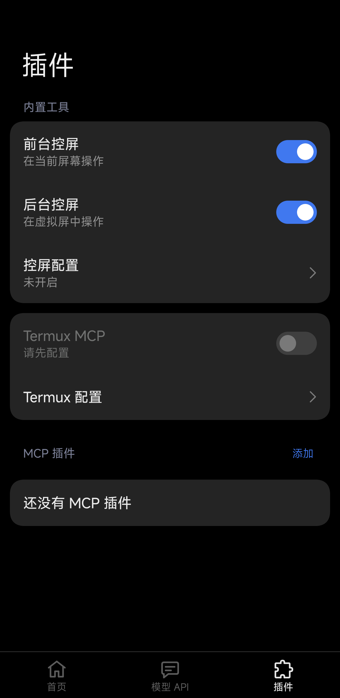

# 设置 UI 重写：文档与实机验证（2026-11-06）

本轮基于工作区内 Claude 重写后的前端，保留已有源码及文档改动；本记录的验证基于包含未提交 UI 源码的工作区，文档提交不包含该源码。主界面拆为独立页面，首页提供插件和控屏快捷入口，导航按实际来源返回，MCP 管理由列表进入独立详情页。界面及维护入口见 [设置界面](../settings-ui.md)。

## 文档与截图

重新运行当前源码的 Robolectric 截图用例，更新首页浅／深色、模型 API、插件浅／深色、控屏、Termux 浅色及深色大字、虚拟屏浅／深色；补充 MCP 详情、运行状态及直接测试图。日志截图也重新生成，内容与已有图一致。已逐页目视对照共用的 Miuix 设置行、箭头／操作色、底栏、标题、间距与文字换行。普通截图为 393 dp，Termux 大字图为 320 dp、1.5 倍字号；不将该项当作所有页面的大字覆盖。

所有文档主图都使用合成配置。虚拟屏成功状态由 mock 返回，日志为合成元数据，不证明真实后端或模型任务。保留历史验证记录中的旧图，避免改变既有证据；性能文档明确旧采样不代表本次重写。

## 本地检查

```sh
./gradlew :app:testDebugUnitTest :app:lintDebug :app:assembleDebug :app:assemblePreview
./gradlew -PuiTestBuildType=preview :app:assemblePreviewAndroidTest
```

使用本机 JDK 25 和项目配置的 SDK 37。540 项 JVM／Robolectric 测试全部通过（0 跳过）；Debug 完整 Lint、Debug／优化 Preview／Preview AndroidTest 构建通过。未在本轮运行 Release 完整 Lint 或 Release 构建，Preview 的 lintVital 不替代 Release 完整 Lint。

## 设备

Xiaomi 25019PNF3C，Android API 37，竖屏 1440×3200，系统深色模式。通过 `adb install -r` 覆盖安装当前完整源码构建的 `1.0.2-preview` 优化 Preview 和对应测试 APK。

插件专项 `SettingsUiRunner -e plugins true` 通过：底栏根页、添加入口对齐、MCP 编辑取消与重建、控屏／虚拟屏选中态、工具栏／系统返回层级、子页点击标签回根页，以及模型草稿离开确认。未发起模型请求或虚拟屏探测；Runner 报告原配置恢复并验证通过。

以下是该专项使用临时合成配置的实机图，裁去系统状态栏和手势条：



完整表单 Runner 启动后未正常结束；第二次显式传入 `-e plugins false` 重试也未完成。运行中曾生成模型／键盘／协议弹窗截图，但没有最终 PASS，不计作整套表单回归通过。通过重新覆盖安装结束未完成的测试后，adb 输出 `Process crashed`；该输出不能用来断言产品发生了独立崩溃。另一次 `uiautomator dump` 返回 `could not get idle state`。原因未定位，不能将其归结为已确认的产品或 Runner 缺陷。

已从安装前的私有备份恢复原设置，再覆盖安装相同 Preview 使进程重新读取；逐项比较配置，仅 `hook_at` 注入报告时间更新，其余键值保持一致。无障碍启用服务列表与测试前一致，未更改 ADB reverse。保留当前 Preview 与对应测试 APK。备份和含设备配置的截图只存本地忽略目录，不加入文档。

恢复后另用 adb 点按并截图核对：首页进入控屏时仍选中首页，系统返回回首页；插件底栏进入插件根页。Termux 二级页本轮仅有本地渲染覆盖，未完成实机确认。页面标题、控件、操作色与底栏未见截断或错位；没有切换开关或触发服务操作。

本轮不重启小爱、不启停 Termux 服务、不发起真实模型任务；不重新证明 Hook、远程 MCP、后台控屏能力或运行性能。原始构建日志和设备输出保存在本地忽略目录 `.tools/ui-rewrite-20261106*`。
